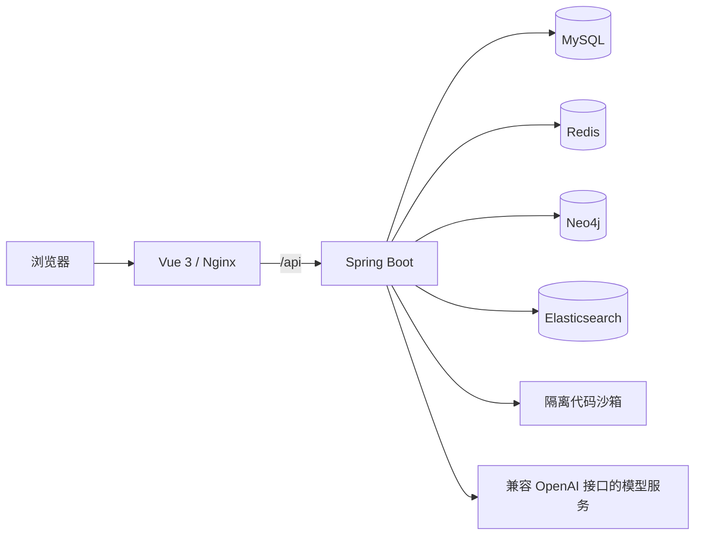

# ZhiCore · 操作系统智能学习平台

ZhiCore 是面向操作系统课程的 AI 教育与学习平台，以 **个性化学习路径规划** 为主线，将课程学习、知识图谱、题目练习、编程实验和 AI 辅导连成学习闭环。学生依据个人学习情况获得下一步建议，在学习和实践中积累证据、巩固知识；教师按班级查看学习情况、布置任务和批阅。仓库名及部分包名沿用 **OSLab**。

## 个性化学习路径规划

1. **了解学习情况**：汇总作答、实验等学习证据和知识点掌握状态，区分薄弱、待巩固与到期复习。
2. **规划补学路径**：围绕目标知识点，结合知识图谱中的前置关系与个人掌握状态，排列需要学习的知识点。
3. **推荐下一步行动**：结合复习安排、学习证据和可用时间，推荐阅读、作答、复测等活动，并说明推荐理由与预计耗时；学习证据更新后可重新生成计划。

规划依据已有学习证据和知识关联，证据不足时先安排验证，不直接判为薄弱。AI 导师结合当前课程和任务提供讲解与辅导，不会凭一次对话直接改写掌握状态。

## 功能

- **学习计划与画像**：展示个人学习状态、到期复习与待完成活动，保留可追溯的学习记录。
- **课程与知识图谱**：按章、节、单元组织资料、题目、实验及关联知识点，支持从图谱直接进入学习。
- **练习与自测**：普通练习逐题反馈；模拟自测交卷后统一展示解析，服务端保存作答与评分结果。
- **编程实验**：Monaco 编辑器、按用户/实验/语言保存的草稿、异步判题，以及带错误上下文的导师求助。恢复初始代码会确认并备份当前草稿。
- **统一学习导师**：全局与场景内入口共享课程上下文，支持规划、概念学习、题目辅导和实验排错；引用课程材料，展示工具执行与降级状态。
- **教师工作台**：班级跟进、学习证据查看、定向任务、提交与批阅；管理员承担教师角色。
- **交互演示**：CPU 调度、内存分配、页面置换、磁盘调度等 18 项算法演示。

默认仅开放操作系统课程。数据库系统资料作为跨课程测试内容保留，须显式配置才会开放。AI 对话不会直接判定学生“已掌握”；学习状态由符合条件的作答、实验等证据更新。

## 技术架构



| 模块 | 技术与依赖清单 |
| --- | --- |
| 前端 | Vue 3、TypeScript、Vue Router、Vuex、Arco Design、ECharts、Monaco；见 [package.json](前端代码/osLab-frontend/package.json) 与 [package-lock.json](前端代码/osLab-frontend/package-lock.json) |
| 后端 | Java 17、Spring Boot 2.7.2、MyBatis-Plus、Spring Session；见 [pom.xml](后端代码/osLab-backend/pom.xml) |
| 数据服务 | MySQL 8.0.36、Redis 7.2.5、Neo4j 4.4.39、Elasticsearch 7.17.22；容器版本见 [Compose](deploy/docker-compose.yml) |
| 代码沙箱 | Python 3 标准库、Docker CLI、JDK 17、GCC/G++、Go；见 [沙箱说明](代码沙箱/README.md) 和 [Dockerfile](代码沙箱/Dockerfile) |

系统结构、数据流及模块职责见 [架构说明](docs/architecture.md)。

## 安装运行

### 方式一：Docker Compose

准备 Git、Docker Engine 或 Docker Desktop，以及 Compose v2。完整服务栈建议预留 8 GB 内存、20 GB 可用磁盘；实际占用取决于模型调用、课程数据与判题并发。

```bash
git clone https://github.com/hunterno-L/OSlab.git
cd OSlab
cp deploy/.env.example deploy/.env
```

编辑 `deploy/.env`，将所有 `replace-with-...` 替换为各自独立的随机值，再启动：

```bash
docker compose --project-name oslab --env-file deploy/.env -f deploy/docker-compose.yml config --quiet
docker compose --project-name oslab --env-file deploy/.env -f deploy/docker-compose.yml up -d --build
docker compose --project-name oslab --env-file deploy/.env -f deploy/docker-compose.yml ps
```

Windows PowerShell 也可从仓库根目录一键运行；脚本会在首次启动时生成 `deploy/.env` 和随机密钥：

```powershell
pwsh -File ./run-local.ps1 -Port 8080
```

默认平台地址为 `http://localhost/`；使用上面的 `-Port 8080` 时为 `http://localhost:8080/`。健康检查为同一地址下的 `/api/health/liveness`。

MySQL 和 Neo4j 仅在新数据卷首次初始化。基础初始化包含学习种子和 41 项实验；五章课程快照的另一种恢复流程见 [数据库说明](数据库文件/README.md)。已有数据卷请按版本检查后增量迁移，不要重复导入基础库。

```bash
# 查看日志；停止服务并保留数据卷
docker compose --project-name oslab --env-file deploy/.env -f deploy/docker-compose.yml logs --tail 100 backend
docker compose --project-name oslab --env-file deploy/.env -f deploy/docker-compose.yml down
```

### 方式二：本机开发

准备 **JDK 17 或更新版本、Node.js 18 或更新版本、npm 9 或更新版本**，以及 MySQL、Redis、Neo4j、Elasticsearch。Maven 由仓库自带 Wrapper 下载，无需单独安装。

1. 按 [数据库说明](数据库文件/README.md) 初始化独立开发库与图数据库。
2. 将根目录 [.env.example](.env.example) 复制为 `.env`，填写本机连接配置。
3. Windows 使用以下脚本启动；它会读取根目录 `.env`、构建后端、安装前端依赖并启动服务：

```powershell
Copy-Item .env.example .env
# 编辑 .env 后运行
pwsh -File ./start-oslab.ps1
pwsh -File ./start-oslab.ps1 -Status
pwsh -File ./stop-oslab.ps1
```

默认前端为 `http://localhost:8081/`，后端为 `http://localhost:8121/api`。端口冲突时可使用 `-FrontendPort`、`-BackendPort`；启动脚本不会关闭其他应用的进程。

Linux/macOS 的手动构建和启动命令、环境变量优先级、账号初始化及故障排查见 [环境配置](docs/environment.md)。

## 环境配置

| 配置入口 | 用途 |
| --- | --- |
| [.env.example](.env.example) | 本机开发：数据库连接、服务端口、AI 和沙箱；复制为根目录 `.env` |
| [deploy/.env.example](deploy/.env.example) | Docker Compose：数据库、缓存、图库、沙箱的密钥与运行参数；复制为 `deploy/.env` |
| [环境配置说明](docs/environment.md) | 完整变量分组、依赖版本、启动方式和可选能力 |
| [数据库说明](数据库文件/README.md) | 首装顺序、五章快照、旧库升级和演示账号 |

`.env`、个人模型密钥和运行数据不提交到 Git。首次使用个人模型配置前需设置并持久保存 `OSLAB_AI_MASTER_KEY`；更换该值后，原有密钥密文将无法解密。未配置模型或沙箱时，界面会说明降级或不可用状态。

实验分为自动评测、概念验证和本地构建。概念测试通过只表示通过该验证程序；标注本地构建的实验须在配套环境执行，不能将在线结果等同于完整内核构建。

## 开发与验证

```bash
# 前端：安装锁定依赖、检查、回归、构建
cd 前端代码/osLab-frontend
npm ci
npm run lint -- --no-fix
npm run test:contracts
npm run build
```

```powershell
# 后端：在 JDK 17+ 下运行，集成测试需先准备隔离测试数据服务
Set-Location 后端代码/osLab-backend
./mvnw.cmd test
./mvnw.cmd -DskipTests package
```

测试分层及无需外部服务的回归命令见 [测试说明](docs/testing.md)，课程包校验与维护见 [内容维护](docs/content.md)，维护工具见 [scripts](scripts/README.md)。构建产物、截图、临时报告和设计草稿均从当前代码树排除；开发过程可通过完整 Git 提交历史查阅。

## 仓库结构

```text
.
├── 前端代码/osLab-frontend/   # 前端源码、公开资源、生成的 API 客户端、测试
├── 后端代码/osLab-backend/   # 后端源码、测试、Maven Wrapper
├── 代码沙箱/                # 内部判题 API 与隔离 Worker
├── 数据库文件/              # 基础库、迁移、图数据及初始化说明
├── content/                 # 课程内容、实验源码和校验材料
├── deploy/                  # Compose、初始化脚本、环境模板、课程快照
├── docs/                    # 架构、环境、测试与内容维护文档
├── scripts/                 # 可复用的校验、导入和开发工具
├── PRODUCT.md / DESIGN.md   # 当前产品与界面约束
├── .env.example             # 本机开发环境模板
├── run-local.ps1            # Docker Compose 管理入口
└── start-oslab.ps1 / stop-oslab.ps1  # Windows 本机开发启停
```

## 团队信息

| 姓名 | 分工 |
| --- | --- |
| 江子涵 | 队长 |
| 刘澈 | 队员，负责开发 |
| 安家成 | 队员，负责测试和维护 |

项目使用的第三方框架与已有教学素材保留原有来源和署名；依赖及基础镜像分别以各自的许可证为准。
