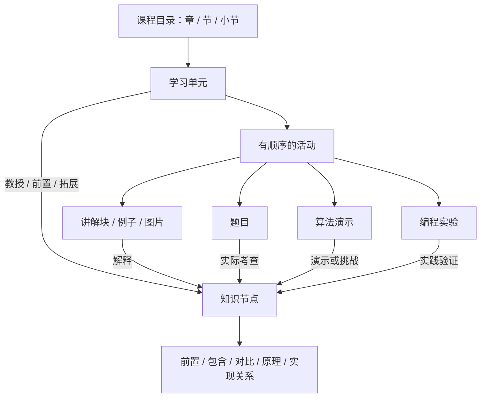

# OSLab 课程与知识图谱总体设计

版本：1.1，2026-10-17。面向L、J、A。参考《王道操作系统》，以提供的目录截图为课程骨架。当前优先交付第一章“计算机系统概述”整章，既有页面置换材料作为后续样板保留。

## 1. 产品决定

学生默认进入课程学习，看到“开始学习／继续学习”、章节目录、当前单元与下一步。知识图谱继续用于概念查询、前置解释、个人诊断和补救，完整图谱保留为探索入口。

采用“教材式主线 + 按证据插入补救”的学习方式。教师编排默认课程顺序，学生可以自由浏览、跳转和复习。出现薄弱点时，系统推荐补充单元，完成后回到原来的主线位置。

### 1.1 保留数字孪生学习画像

数字孪生设计继续作为平台的核心能力：公共知识图谱保存课程知识及关系，每个学生叠加自己的概念掌握、实践表现、证据数量、最近变化和下一步建议。同一节点对不同学生呈现不同状态，课程目录让学生知道怎么学，个人图谱让学生知道学得如何。

复用现有学习事件、概念／实践双维 BKT、个人图谱与时间快照。节点详情要能解释“由哪次作答或实验形成这个状态”，历史回放依据事件快照展示变化。新目录和学习单元通过稳定 nodeCode 接入这套画像，不另建一套单元掌握模型。

第一章没有适合的编程实验或模拟挑战时，实践维度显示“未评估／暂无实践证据”，不显示为知识薄弱或用概念分填满。阅读、观看、完成单元记录进度；服务端核验的作答、挑战与判题结果才形成对应掌握证据。前置关系用于补救推荐，不把相邻节点的推测当作直接测得的掌握证据。

### 1.2 三个独立资源入口

题目练习、算法模拟、编程实验均保留可直接进入的列表与工作页面；它们也可以被学习单元引用。学生能够随时做题、自由模拟或提交实验，无需先打开课程单元或图谱节点。

| 入口 | 当前路径 | 改造后行为 |
| --- | --- | --- |
| 题目练习 | `/assessments` | 独立题库、筛选、作答与复习 |
| 算法模拟 | `/experiments/simulation` | 独立选择算法、自定义输入和挑战 |
| 编程实验 | `/experiments`、`/experiments/code/:id` | 独立实验列表、代码编辑、提交与记录 |

首页或全局导航可直接识别这三项；可沿用实验中心分组，但算法模拟与编程实验分别可点击。单元内外复用同一资源 ID、判分服务与学习事件。独立作答更新个人画像；只有明确关联当前活动的结果才完成该活动，不擅自完成所有复用它的单元。

## 2. 四种对象及其区别

| 对象 | 例子 | 职责 |
| --- | --- | --- |
| 目录项 | 第3章内存管理／3.2虚拟内存管理／3.2.4页面置换算法 | 章节层级、教材位置与展示顺序 |
| 学习单元 | 理解并推演 LRU | 学习目标、连贯内容、活动顺序与完成条件 |
| 知识节点 | LRU、页面置换、缺页中断、局部性原理 | 可复用的知识实体、关系和掌握证据 |
| 学习资源 | 讲解块、例题、图片、题目、算法演示、编程实验 | 实际呈现或执行的内容 |

目录可以多层嵌套。单元挂在目录的内容叶子位置，界面直接显示为可点击条目；不要求学生看到“单元”技术名称，也不强行在每个目录条目下增加一层。

资源与节点为多对多；单元与资源为多对多。同一 LRU 题目可以服务初学、章节复习和补救，同一演示可以使用不同案例与任务说明。资源只保存一份，单元保存引用与配置。

## 3. 教材目录如何进入平台

五个顶层章节：

1. 计算机系统概述。
2. 进程与线程。
3. 内存管理。
4. 文件管理。
5. 输入／输出（I/O）管理。

目录中的正文标题建为 `CONTENT` 类型目录项；习题、答案、小结、疑难点分别映射为练习集合、反馈材料、总结活动和章节复习。它们不自动生成同名知识节点。

带星号内容标记为 `extension`，由L选择是否纳入必学单元。教材节号和标题保留供定位，系统内部编号不随着展示顺序改变。

当前图谱的“硬件管理／中断与系统调用”等分组和教材章节不同。课程目录以教材为准，旧分组作为历史标签或实验主题保留；不要把所有旧 `chapter` 字符串原地替换后当成新目录。

## 4. 单元划分与教学编排

单元围绕一个可验证目标：例如“能根据访问历史推演 LRU 淘汰过程”。目标比“了解 LRU”具体，也不要求每个概念都拆成独立页面。

- 两个短小且连续的知识点可合并为一个单元。
- 算法机制、综合例题等内容可拆成多个单元。
- 单元主体一般安排一个目标和少量紧密相关知识；时间估计供学习规划，不作为完成条件。
- 非算法单元可以只有讲解、例子和测评；综合编程实验安排在多个单元之后。

活动类型统一为：`READING`、`WORKED_EXAMPLE`、`DEMO`、`PRACTICE`、`ASSESSMENT`、`EXPERIMENT`、`SUMMARY`。展示名称使用“阅读／跟随例子／互动演示／练习／测评／编程实验／小结”。

### 4.1 LRU 单元样板

| 顺序 | 活动 | 学生任务 | 完成条件 |
| --- | --- | --- | --- |
| 1 | 阅读算法规则 | 理解“最近访问”与“最早调入”的区别 | 明确点击阅读完成 |
| 2 | 跟随例子 | 观察 3 页框下 `1,2,3,1,4` 的变化 | 确认例子完成 |
| 3 | 互动演示 | 改变序列观察淘汰变化，可自由探索 | 演示达到指定终步，只计进度 |
| 4 | 预测挑战（测评活动） | 预测下一步淘汰页面 | 后端判分；记录真实结果 |
| 5 | 题目练习 | 完成命中更新、淘汰规则等题 | 提交指定题目即可完成步骤，错题显示补充建议 |
| 6 | 小结 | 归纳规则，选择继续或实践 | 完成小结；进入下一单元 |

挑战初期可使用现有单空／单选题判定，题目附带同一案例配置，避免每个旧演示都必须立即开发新的预测接口。已有服务端预测计算的 FIFO/LRU 可直接接入。

“完成活动”与“达到单元目标”分别展示。默认允许学生完成学习流程后继续前进；单元测评结果显示通过或建议复习。必须达标的任务由L在活动配置中明确标记，不默认把所有后续课程锁住。

### 4.2 第一章交付与后续样板

当前首发范围是第一章“计算机系统概述”，按 1.1—1.6 编排学习单元，1.7 作为本章复习资源和综合测评入口。初稿分为十个教学条目，收到正文后调整粒度，详见 [第一章交付方案](06-第一章交付方案与资料清单.md)。没有算法或编程任务的概念单元，以内容、情境判断与测评形成完整流程。

`3.2.4 页面置换算法` 下编排：置换基础、FIFO、LRU、OPT、CLOCK、改进型 CLOCK、算法比较，共七个单元。页表、缺页中断、局部性原理是相关前置或支撑知识，单独对应其他目录中的学习内容，不复制成多份节点。

已整理的后续样板材料和活动顺序见 [页面置换交接](../../content/operating-systems/wangdao-2025/handoffs/memory-page-replacement-001.md)。原教材的 OPT 优先讲授顺序保留在出处中；单元按逐步引入信息维护的教学顺序编排。CLOCK 暂用图文和测评，演示资源就绪后再增加活动。

LRU 单元不必关联所有背景知识为考查对象。例题题面提到页框，不意味着这道题能验证页表结构、地址翻译等全部知识。

## 5. 知识图谱结构

### 5.1 节点粒度

核心层保存概念、算法、机制；实现层保存函数、结构体及具体系统实例。初学视图优先显示核心层，进入实验后再展开实现层。

分类字段 `nodeType` 使用 `CONCEPT`、`ALGORITHM`、`MECHANISM`、`IMPLEMENTATION`；教材页码、文本块、小结和题目不是知识节点。类别用于过滤，不能与目录层级混用。

每个节点使用稳定 `nodeCode`，如 `os.memory.lru`。名称是显示属性，别名用于检索。两个不同领域的 FCFS 分别使用 `os.cpu.fcfs` 和 `os.disk.fcfs`，避免名称相同造成错误合并。

### 5.2 关系词表与方向

| 关系代码 | 含义与方向 | 例子 | 是否用于前置排序 |
| --- | --- | --- | --- |
| `REQUIRES` | A → B：理解 A 需要先理解 B | 页面置换 → 缺页中断 | 是 |
| `CONTAINS` | A → B：A 包含 B | 页面置换算法 → LRU | 否 |
| `CONTRASTS_WITH` | A 与 B 对比，语义无方向，保存时按代码排序去重 | FIFO 与 LRU | 否 |
| `BASED_ON` | A → B：A 的设计依据 B | LRU → 局部性原理 | 否 |
| `IMPLEMENTS` | A → B：A 是 B 的具体实现 | 某实验实现 → LRU | 否 |
| `RELATED_TO` | A 与 B 一般关联，语义无方向 | 无法归入上述类型的明确关联 | 否 |

`REQUIRES` 与现有 `dependent` 方向一致：A 依赖 B，先 B 后 A。学习路径展示可以画 B → A，但导入文件仍保持 A → B，避免重复反向转换。

`BASED_ON` 不自动升级成必学门槛。只有确实需要先理解的节点才另建 `REQUIRES`。一般关联需要文字依据，优先使用明确类型，避免把同页出现的术语全部连边。

J 提供关系依据与出处；L决定正式结构。前置关系应能形成合理顺序；对比、相关关系允许成环。

## 6. 文本与资源组织

J 的第一层切割按语义完整性进行：定义、机制解释、算法步骤、完整例题、图表和误区。每块有稳定 `chunkCode`，保留标题路径、印刷页码、正文、图片和关联节点。

图表及相关解释不能只按字数拆散。算法步骤保留顺序，例题保留条件、推演与结论。一个块可以关联多个节点，一个节点可以由多个块解释。

用于 AI 检索的较小片段由系统从这些教学块生成，保留 `parentChunkCode` 和来源；不要求 J 额外制作一套检索片段。

来源区分 `TEXTBOOK`、`ADAPTED`、`SELF_AUTHORED`、`SELF_AUTHORED_SAMPLE`。教材原文、改写和自编例子分别标注，授权状态已确认，不再增加授权流程。

## 7. 题目、演示与实验的关联

题目自身记录 `nodeMappings`，每项包含 `nodeCode`、`role`、`weight`；核心考查节点为 `PRIMARY`，次要但确实可测节点为 `SECONDARY`。背景知识放单元的前置引用，不作为自动更新对象。

初始建议主节点权重 1.0，次节点 0.3，L可调整。这是模型影响强度，不是分数占比，不要求总和等于 1。现有旧题目导入无法写该权重，新接口需实现。

现有模型将权重用于综合掌握值的更新幅度，概念／实践分项沿用既有规则。本次课程重构复用该模型，先解决内容映射、教学顺序与进度，不同时改动历史 BKT 契约。

编程实验使用独立 `experiment_node` 映射，逐步替代从 `tags` 推断知识节点；标签继续用于展示和筛选。

A 负责维护已有实验的题面、样例、参考解和测试用例，并逐项建立实验到新 nodeCode、实验到 unitCode 的映射。节点映射描述实际考查能力，单元映射描述安排在哪学习，二者分别维护。缺少知识节点时由 A 提出候选，J 补充语义与出处，L确认编号和结构。保留旧 questionId 及提交历史，综合实验允许关联多个单元。

演示资源有稳定 `resourceCode` 和 `algorithmKey`。自由探索只记进度；独立预测或挑战经后端核验后形成学习证据。采用现有 OPT 仅对比、不写实践证据的约定；可用其对应知识测评检验概念理解。

## 8. 18 个现成算法演示的安排

| 主题 | 资源 | 教材归属 |
| --- | --- | --- |
| CPU 调度 | FCFS、SJF、HRRN、非抢占优先级、抢占优先级、RR、MLFQ | 2.2.5 典型调度算法 |
| 内存分配 | FF、BF、WF、NF | 3.1.2 连续分配管理方式 |
| 页面置换 | FIFO、LRU、OPT | 3.2.4 页面置换算法 |
| 磁盘调度 | FCFS、SSTF、SCAN、C-SCAN | 5.3.3 磁盘调度算法 |

旧资源项目位于 `E:/web/web/demo_operatingsystem 2025.5.26/demo_operatingsystem/`，Vue 2 + Element UI。当前源码存在 18 个演示入口，尚不代表所有算法已经运行验证。

现有 OSLab FIFO/LRU/OPT 和 FCFS/SJF/RR 后端及界面优先复用。旧项目用于补充可视化和新增算法；共享模拟器与算法服务，同时服务独立算法模拟入口和单元内活动。单元只增加教学任务、配置和返回位置。

## 9. 页面设计（待定）

### 9.1 学生首页

主内容为当前课程与“开始学习／继续学习”，显示所在章、单元目标、待完成活动和最近的学习位置。目录入口清晰，图谱、自由练习和实验作为辅助入口。

新生从教师编排的首个已发布单元开始，已有学习记录的学生回到最后未完成活动。系统不能再从全图列表中任取第一个节点作为起点。

### 9.2 单元页面

左侧目录定位当前单元；中间为连贯阅读和当前活动；右侧或抽屉显示相关知识、补充解释与导师。顶部显示教材目录路径和单元目标，底部主要操作为继续／提交／下一单元。

只有当前活动需要的编辑器、题卡或演示出现，不把所有模块同时堆满页面。延续已确认的 OpenDesign 浅色、细边框、蓝色主强调风格。

### 9.3 节点工作台

保留完整节点工作台作为概念查询与诊断页，新增“在哪些单元学习”入口。单元内点击术语打开节点抽屉，关闭后恢复原位置。工作台与单元复用题卡、模拟、实验入口、导师和证据组件。

## 10. 进度与证据

| 数据 | 表达什么 | 触发来源 |
| --- | --- | --- |
| 活动进度 | 是否阅读、运行、提交或完成指定活动 | 当前学生的真实活动行为 |
| 单元进度 | 必需活动完成比例、当前位置、完成状态 | 活动进度聚合 |
| 达标情况 | 单元检查点是否通过、建议复习哪些知识 | 服务端测评或判题结果 |
| 节点掌握 | 累积的概念与实践证据 | 现有学习事件与 BKT |

一份真实作答只判分和计证据一次，再用于更新活动进度。复用同一题到其他单元时不制造新题目 ID，也不把重复作答伪装成首次独立观测。

## 11. 三人协作交接

L先发布目录骨架、词表和导入格式；J 与 A 并行整理。J 提交节点与素材，A 使用相同节点代码完成题目。新节点正式入库后，再导入引用它们的题目。

A 同时完成已有编程实验盘点、内容维护、节点映射与单元映射材料。J、A 只提交完整资源包，L 统一校验、导入、保存映射并联调发布。J 协助补充实验所需的新知识节点。具体执行见 [A 的实验指南](07-成员A编程实验维护与映射指南.md)。

每批附短交接说明：范围、数量、未确定条目、结构建议、核对结果。L据此安排学习单元，审核并发布。单元设计由L承担，J 可给内容顺序建议，A 可给练习用途建议。

## 12. 本轮完成标准

1. 新生能从目录开始学习，返回用户能继续上次位置。
2. 第一章整章可按顺序学习、测评、补救与继续；适用的模拟／实验另行接入，保留 LRU 为后续算法闭环样板。
3. J、A 按同一词表交包，L 统一导入；改名和重复导入不会破坏关联或复制题目。
4. 节点工作台可查询原有证据，并能返回所在单元。
5. 第一批素材有准确出处，题目有答案和解析，旧学生历史仍可回放。
6. 三个独立资源入口可直接使用；个人数字孪生画像在课程内外持续更新，并能区分无证据与薄弱。
