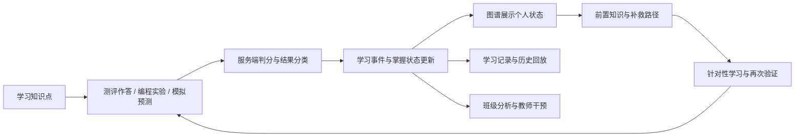
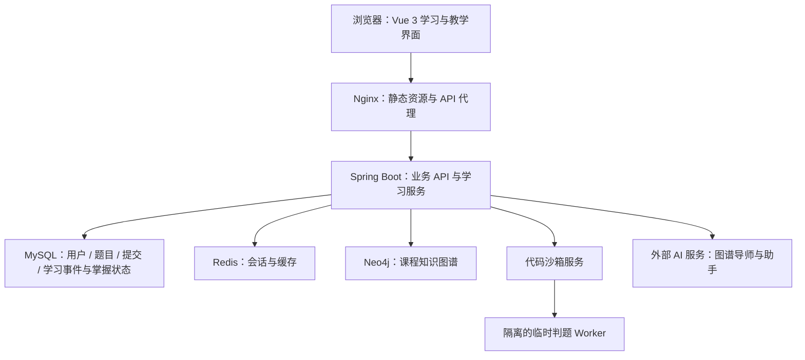

# OSLab 操作系统智能学习平台

## 项目介绍与交付说明

> 面向操作系统课程，以知识图谱组织学习内容，以题目作答、编程实验和交互模拟形成学习证据，连接学生学习与教师教学分析。
>
> 文档日期：2026-10-13。源码基线：`93ccf44`。适用对象：项目接收方、授课教师、后续开发人员及项目展示人员。
>
> 本文依据当前工作区源码、2026-10-06 本地验收报告及 2026-10-07 线上验收运行清单整理。验证结果为已有记录，本次文档整理未重新运行测试。

## 1. 项目概述

OSLab 是面向高校操作系统课程的 Web 学习与实验平台。平台将课程知识点、知识测评、编程实验、算法模拟和学习记录连接起来，帮助学生理解知识之间的关系，也帮助教师判断学生在哪些环节需要补充讲解和练习。

平台的核心是“基于知识图谱与学习证据的教学闭环”：学生完成一次有效学习活动后，系统记录结果及相关知识点，更新个人掌握状态，再给出下一步学习建议。教师可以从班级视角查看这些证据，定位共性薄弱点。

项目主要服务三类需求：

- **学生自主学习**：沿章节和知识关系学习，结合练习、算法演示与代码实现验证理解，及时补足前置知识。
- **教师组织教学**：维护课程内容与题目，观察班级掌握情况，根据真实作答和实验结果调整教学重点。
- **项目演示与后续开发**：通过一条完整、可解释的学习路径展示平台能力，并提供源码、数据初始化脚本及验证材料供接手维护。

当前版本已形成可演示、可试用的主要学习流程。全课程内容质量、真实教学效果及完整生产环境验收，仍是下一步工作的重点。

## 2. 产品目标与核心价值

### 2.1 让知识关系参与学习决策

知识图谱表达概念、算法和功能之间的关系。学生可以查看课程结构，也可以在个人掌握视图中查看自己的学习状态。发生知识失误时，系统结合前置关系组织补救路径，使“应该先学什么”具有明确依据。

### 2.2 同时观察概念理解和实践应用

平台分别记录知识测评与编程实验、模拟预测产生的证据，展示概念理解和实践应用两个维度。学生可以发现“题目能够答对，但代码实现仍有困难”这类差异，教师也能据此安排不同形式的补充活动。

### 2.3 让诊断能够追溯到具体行为

掌握状态、失败归因和学习建议与具体题目、提交记录或模拟预测关联。学习记录保留掌握度变化前后的快照，便于学生理解状态变化，也便于教师复核。

### 2.4 控制课程建设工作量

平台使用统一的节点学习工作台，将知识说明、共享素材、关联题目和实验组合呈现。重点节点可以配置更完整的内容和交互模拟，已有 HTML 讲义可以继续复用，课程建设可以逐章推进。

## 3. 已实现的主要功能

### 3.1 学生学习功能

| 功能模块 | 当前能力 | 主要作用 |
| --- | --- | --- |
| 知识图谱 | 课程结构与个人掌握视图；知识点搜索；章节、类型和状态筛选；节点详情；学习路径聚焦 | 了解课程结构，定位下一步学习目标 |
| 节点学习工作台 | 知识内容、知识详解、题目练习、实践四个页签；关联资源与图谱导师 | 在一个工作区内完成某个知识点的学习和验证 |
| 知识测评 | 判断、单选、多选、填空四种题型；服务端判分；章节与知识点目录；单题练习和连续测评 | 检验概念理解，形成可追溯的作答证据 |
| 编程实验 | Monaco 代码编辑器；Java、C、C++、Go 判题接入；异步查询结果；按用户、实验和语言保存草稿 | 验证知识在程序实现中的应用 |
| 页面置换模拟 | FIFO、LRU、OPT；逐步执行、播放及算法结果对比；页面缺失和淘汰预测 | 观察访问序列、内存状态和置换策略之间的关系 |
| CPU 调度模拟 | FCFS、SJF、RR；执行过程展示及调度预测 | 理解不同调度策略对执行顺序和指标的影响 |
| 学习记录 | 作答、判题、模拟事件时间线；待巩固内容；历史掌握状态回放 | 回顾学习过程，查看状态变化的依据 |
| 学习资源 | 课程讲义与相关知识点关联，复用已有交互资源 | 提供补充解释和学习材料 |
| AI 辅助 | 节点图谱导师；带页面上下文的全局助手；实验失败后带提交上下文提问 | 辅助解释概念和分析学习问题 |
| 个人资料 | 账号信息、昵称与头像 URL 编辑；统一头像和显示名称逻辑 | 保持顶栏和个人资料页的身份信息一致 |

图谱当前课程数据基线为 **150 个节点、171 条关系**。这些数字描述当前课程数据集，后续增删节点或关系时应以实际接口结果为准。

### 3.2 教学与管理功能

| 功能模块 | 当前能力 |
| --- | --- |
| 班级学习分析 | 班级薄弱点列表与热力图谱；节点下钻；首次作答正确率、实验通过率和误区统计；班级事件时间线 |
| 课程覆盖分析 | 查看章节及知识点关联内容、题目和实验的完整情况，为内容建设提供依据 |
| 测评管理 | 四类题目创建与编辑；提交审核、发布、下线；驳回理由；JSON 导入预览与提交 |
| 知识维护 | 图谱节点、关系、章节维护；节点学习素材编辑与发布 |
| 实验管理 | 编程实验创建、编辑及删除；章节题目集维护 |
| 用户管理 | 学生查询、批量导入与密码重置 |

当前教学管理权限由 `admin` 角色承担，学生侧使用 `user` 角色。教师业务页面已实现，但独立教师角色及按课程、班级分配权限仍属后续计划。

### 3.3 界面与交互

前端沿用已确认的 OpenDesign 视觉方向：浅色背景、蓝色主强调色、细边框和克制的状态配色，以课程内容和主要操作为视觉重点。

学习区与教学管理区分别组织导航和布局。图谱采用画布与节点详情并列的工作方式；题目练习采用章节、知识点到单题的学习流程；实验区将题目说明、代码和运行结果放在同一工作区。

头像加载失败时采用名称首字等后备展示，昵称与账号名称使用统一规则。图谱空白、节点与标签分离、关系标签和缩放后的显示问题已纳入修复与回归检查；最终视觉效果仍以人工审核为准。

## 4. 学习闭环与典型使用场景



以 LRU 页面置换算法为例：

1. 学生在图谱或章节目录中进入页面置换相关知识点，阅读算法说明和前置知识。
2. 完成判断或选择题，服务端判分并返回解析。有效作答形成学习证据，相关节点显示个人掌握状态。
3. 如果表现薄弱，系统给出前置知识和补救路径，学生可以直接进入对应内容或练习。
4. 在页面置换模拟中观察 FIFO 与 LRU 的执行差异，预测是否缺页以及淘汰页面；服务端重算结果并判断预测是否正确。
5. 在编程实验中实现算法并提交代码，查看异步判题结果。需要帮助时，携带题目、代码及判题上下文向导师提问。
6. 修正理解或实现后再次验证，学习记录保留新的结果，图谱根据累积证据调整状态。
7. 学生回放学习过程，教师查看班级中是否存在“命中后未更新访问顺序”等共性误区。

状态变化取决于模型、关联权重和已有证据。一次答对不保证立即显示“已掌握”；编译错误或系统错误保留诊断记录，不作为知识掌握失误计入模型。OPT 预测用于算法对比，当前不写入学习证据。

## 5. 关键实现机制

### 5.1 知识结构与个人学习状态

Neo4j 保存课程节点及依赖、包含、相关、实现四类关系。MySQL 保存学生与节点之间的掌握状态。同一课程图谱可以展示不同学生的状态，也能展示班级层面的统计结果。

依赖关系用于判断学习先后顺序。例如，“A 依赖 B”表示先学习 B，再学习 A。补救路径结合前置知识、薄弱状态及实际关联资源生成可执行的学习步骤。

### 5.2 掌握度与学习证据

平台采用贝叶斯知识追踪模型 BKT，当前默认参数为 `pInit=0.10`、`pLearn=0.10`、`pGuess=0.20`、`pSlip=0.10`。学习转移项对正确和错误观测均生效。

概念理解与实践应用分别累计证据。未学习节点单独标识；已观测节点按阈值显示薄弱、待巩固或已掌握，其中“已掌握”还需要概念和实践两类证据支持。当前证据可信度采用去重来源数估算，上限为 1，尚未经过真实课堂数据校准。

学习事件保存行为来源、结果、幂等标识及掌握状态前后快照。同一道测评题重复作答可以保留学习记录，但仅首次独立作答用于该题的概念观测，避免重复操作制造证据。

### 5.3 服务端判分与代码判题

测评答案和判分规则在服务端执行。连续测评的题目队列由服务端保存，提交具有幂等约束。编程实验通过后端连接代码沙箱执行，浏览器负责编辑、提交和展示结果。

仓库提供真实 Docker 沙箱实现，以及用于开发和接口联调的回显沙箱。回显沙箱用于验证请求和事件链路，真实程序执行能力需依据真实沙箱运行结果判断。

### 5.4 图谱导师与 AI 辅助

节点导师以图谱邻域、已发布学习素材及当前学生的相关学习事件组织上下文，并提供可追溯的来源入口。实验提问可以附带当前题目、代码和判题结果。

判分、掌握度更新、规则归因和路径规划具备独立实现。外部 AI 不可用时，节点导师可以降级为规则回答，主要学习流程继续运行；全局 AI 助手的模型回答仍需要配置有效的 AI 服务。

## 6. 技术架构



MySQL、Redis、Neo4j、代码沙箱和 AI 服务分别由后端访问。Compose 配置中还保留 Elasticsearch 检索服务，主要学习闭环以 MySQL 和 Neo4j 为核心数据存储。

| 层次 | 当前技术与职责 |
| --- | --- |
| 前端 | Vue 3、TypeScript、Arco Design Vue、ECharts、Monaco；学习界面、图谱、编辑器及结果展示 |
| 后端 | Spring Boot 2.7.2、MyBatis-Plus、Spring Session Redis；账号权限、测评、判题、学习事件、掌握度与教学统计 |
| 关系数据库 | MySQL；业务记录和学习状态持久化 |
| 图数据库 | Neo4j；课程节点、关系及知识邻域查询 |
| 会话与缓存 | Redis；登录会话和缓存支撑 |
| 判题服务 | Python 沙箱服务与 Docker Worker；Java、C、C++、Go 程序执行 |
| AI 服务 | 火山方舟 SDK 接入模型；基于课程上下文的解释和问答 |
| 运行与部署 | Docker Compose、Nginx、PowerShell 启停和验收脚本；后端容器采用 JDK/JRE 17 |

学习域数据包括题目与节点映射、作答记录、测评会话、学习事件、个人掌握状态、审核记录和节点素材。数据库目录包含基础库、版本迁移、内容种子及存量库增量检查脚本。

## 7. 交付内容与项目结构

| 交付内容 | 路径 | 用途 |
| --- | --- | --- |
| 前端源码 | `前端代码/osLab-frontend/` | 学习区、教学区、图谱、模拟、个人资料等界面 |
| 后端源码 | `后端代码/osLab-backend/` | 业务 API、判分、学习模型、路径规划及统计 |
| 代码沙箱 | `代码沙箱/` | 判题服务及真实程序执行环境 |
| 数据库资料 | `数据库文件/` | 基础 SQL、迁移、内容种子和存量库检查 |
| 容器部署 | `deploy/` | Compose、环境变量模板、初始化加载器及部署说明 |
| 本地启停 | `run-local.ps1`、`start-oslab.ps1`、`stop-oslab.ps1` | Docker 启动及原生 Windows 开发启停 |
| 验收与辅助脚本 | `scripts/` | 学习链路验收、演示账号准备、术语检查及判题样例 |
| 设计与文档 | `design/`、`docs/` | 设计资产、执行记录、验收报告和人工审核清单 |
| 验证产物 | `artifacts/final-check/` | 已保存的运行清单及测试证据 |

环境密钥、服务器访问权限和正式账号凭据由交付方另行提供。接收方应按实际环境配置数据库、Neo4j、Redis、沙箱及可选 AI 服务。

## 8. 部署与接手使用

### 8.1 Docker 运行入口

准备 Docker Engine 或 Docker Desktop、Docker Compose v2、至少 4 GB 可用内存及空闲访问端口，在仓库根目录执行：

```powershell
powershell -ExecutionPolicy Bypass -File ./run-local.ps1
```

首次运行会创建 `deploy/.env`、生成本地服务密钥、构建并启动服务，等待存活检查返回成功。默认访问 `http://localhost/`。

若需要使用其他端口：

```powershell
powershell -ExecutionPolicy Bypass -File ./run-local.ps1 -Port 8080
```

服务状态与日志入口：

```powershell
powershell -ExecutionPolicy Bypass -File ./run-local.ps1 -Action status
powershell -ExecutionPolicy Bypass -File ./run-local.ps1 -Action logs
```

存活检查用于确认应用进程可响应。完整交付验收还应覆盖数据库初始化、登录、图谱、作答与真实判题。初始化顺序、环境配置及故障排查见 [Docker 部署说明](../deploy/README.md)。

### 8.2 原生 Windows 开发入口

原生方式需要已配置的 MySQL、Redis、Neo4j、兼容 JDK、Node.js、前端依赖及后端构建产物。`start-oslab.ps1` 当前包含开发者本机 JDK 路径，迁移机器时应先按实际安装位置调整，并核对服务名称和连接配置。

```powershell
powershell -ExecutionPolicy Bypass -File ./start-oslab.ps1
powershell -ExecutionPolicy Bypass -File ./stop-oslab.ps1
```

后端默认端口为 `8121`，前端开发服务通常为 `8080`，端口被占用时可能使用 `8081`，以启动日志为准。原生环境使用回显沙箱时适合联调；展示真实代码执行时应配置真实沙箱。

### 8.3 账号与主要页面

仓库提供 `scripts/dev/prepare-demo-accounts.ps1` 准备演示账号。教学演示使用 `teacher_demo`，学生演示使用 `student_demo1`、`student_demo2`，班级为 `os2026`。实际口令以交付方提供或脚本指定的值为准。

| 页面 | 入口 |
| --- | --- |
| 登录 / 注册 | `/user/login`、`/user/register` |
| 学习首页 / 知识图谱 | `/home`、`/graph` |
| 节点学习工作台 | `/knowledge/node/:nodeName` |
| 知识测评 | `/assessments` |
| 编程实验 / 实验工作区 | `/experiments`、`/experiments/code/:id` |
| 交互模拟 | `/experiments/simulation` |
| 学习记录 / 学习资源 | `/records`、`/resources` |
| 个人资料 | `/account` |
| 班级分析 / 知识维护 | `/teaching/overview`、`/teaching/knowledge` |
| 测评管理 / 实验管理 / 用户管理 | `/teaching/assessments`、`/teaching/experiments`、`/teaching/users` |

建议交接演示采用“进入节点 → 作答 → 查看图谱证据 → 补救学习 → 模拟预测 → 提交实验 → 查看记录 → 教师班级分析”的主线。两个学生账号可用于展示个人状态差异和数据隔离。

## 9. 已有验证结果与当前交付状态

| 验证范围 | 记录日期 | 已记录结果 |
| --- | --- | --- |
| 前端静态检查与构建 | 2026-10-06 | lint：0 errors、60 warnings；生产构建成功；身份、工作台缓存、图谱渲染专项 Node 测试通过 |
| 后端默认测试与打包 | 2026-10-06 | 169 项测试，0 failures、0 errors、1 skipped；打包成功；遗留模板测试另行隔离 |
| 存量数据库升级 | 2026-10-06 | 增量检查通过；学习内容种子完整性检查为 12/12 素材、26/26 题目 |
| 本地回显沙箱链路 | 2026-10-06 | PASS=80、FAIL=0、SKIP=7，共 87 项；用于验证接口、事件和状态链路 |
| 线上 API 与 Real 模式链路 | 2026-10-07 | `http://39.106.136.15/api`：PASS=86、FAIL=0、SKIP=1，共 87 项 |
| 全新 Docker 数据卷初始化 | — | 已交付加载器、迁移与检查脚本，现有记录尚未证明全新环境完整实跑 |
| 全站人工视觉与交互审核 | — | 已交付人工清单，现有材料尚未包含完整的人工审核结论 |

2026-10-07 线上记录覆盖了登录、个人图谱、题目审核与作答、模拟、教师接口、历史快照，以及 Accepted、Wrong Answer、Compile Error 和系统错误的判题与事件行为。唯一跳过项是种子题内容已经一致，因此无需执行修复 UPDATE。

这份较新的记录补充了 2026-10-06 报告中尚未执行的真实判题验证。它没有覆盖全部语言与所有运行异常组合，也没有记录线上构建提交号，因此不能据此认定 Java、C、C++、Go 的所有判题路径及全新部署均已完成验收。

头像昵称统一逻辑、图谱渲染修正、实验编辑入口和数据库初始化补齐已有源码与检查记录支持。它们应继续作为人工回归点，不再作为未实施功能列入后续开发范围。

详细证据见 [本地最终验收报告](最终验收报告-2026-10-06.md)、[线上 Real 模式运行清单](../artifacts/final-check/verify-learning-deploy-public2.txt) 和 [最终人工审核清单](最终人工审核清单.md)。

## 10. 当前不足

### 10.1 课程内容覆盖仍不均衡

图谱结构已覆盖多个章节，但经过整理的学习内容和测评种子主要集中在页面置换、CPU 调度等知识链。当前 12 份素材和 26 道内容种子题是重点资源集，并不代表全部节点都已具备完整内容、题型和实验。

文件系统、硬件管理、中断与系统调用等章节仍需要逐节点核对内容准确性、前置关系、题目难度与实验可运行性。资源较少的节点可以浏览结构，但教学体验还不够完整。

### 10.2 掌握度模型尚未经过课堂数据校准

BKT 使用通用默认参数，证据可信度也是来源数量的规则估算。现有测试证明计算与约定一致，还不能证明显示的掌握概率能够准确预测真实学习表现。

目前尚无完整的课堂试用报告，无法量化补救路径是否提高学习效率、是否降低重复错误，或是否帮助教师更快识别共性问题。

### 10.3 代码错误归因的精细度有限

当前归因主要依赖题目关联节点、判题类型及规则，对知识点的关联具有解释性。它还没有建立“具体代码行 → 算法步骤 → 知识点误区”的可靠对应，复杂程序中的错误仍需结合代码和执行过程分析。

图谱导师已有课程上下文和来源支持，但回答质量取决于素材完整度、关联准确性及外部模型服务，尚缺系统化的回答质量评估。

### 10.4 教学权限与个人资料功能仍有简化

教学管理由管理员角色承担，尚未提供独立教师角色、课程负责人和班级范围权限。多门课程、多位教师共同使用时，需要进一步细化职责与可见数据范围。

个人资料目前支持昵称和头像 URL 编辑，统一显示与加载失败后备逻辑已修复；站内头像上传、裁剪与文件存储流程仍未完善。

### 10.5 大规模使用和历史回放存在边界

图谱目前以约 150 个节点的课程规模为基线，数千节点下的布局、可读性和性能还缺少验证。历史回放将旧状态叠加在当前课程拓扑上，尚不保存完整的历史课程结构版本；前端单次回放收集上限为 5,000 条事件。

掌握度写入采用单实例内的并发协调，多实例部署仍需验证数据库级一致性。大班同时提交、长时间运行和外部服务波动下的容量与稳定性尚缺实测数据。

### 10.6 完整部署与视觉验收尚需补齐

已有线上接口和真实判题结果，但全新 Docker 数据卷初始化、四种语言的运行错误及超时等路径仍需补充验证。原生启动脚本带有本机路径配置，环境迁移便利性有待改善。

当前前端还保留 60 项 lint 警告；人工清单覆盖图谱缩放、关系标签、头像昵称、窄屏布局和主要学习流程，但现有交付材料尚未包含完整人工结论。后续应重点完成这些实际使用场景的回归。

## 11. 未来计划

后续工作按交付完整性、教学价值、能力拓展的顺序推进。以下为规划内容，尚未作为已完成功能交付。

### 11.1 优先完成交付验收与环境迁移

**目标：接收方可以在新环境中稳定启动平台，复现主要学习链路。**

- 在全新 Docker 数据卷上完成初始化、首次登录、图谱加载、作答、模拟及真实代码提交，记录环境和实际构建版本。
- 补充 Java、C、C++、Go 的正确结果、错误结果、编译错误、运行错误和超时样例，核对判题与学习事件行为。
- 由人工完成全站视觉与交互回归，重点核对图谱缩放和标签、头像昵称同步、页面布局、实验编辑器及导航；根据实际结果修复问题。
- 将原生脚本的 JDK 路径和连接配置改为可配置参数，完善接收方首次运行说明，并逐步消除现有 lint 警告。

完成标志：新环境运行记录、真实判题覆盖清单、人工审核结论和可追溯的部署版本齐备。

### 11.2 建设可完整使用的课程内容

**目标：主要章节中的知识点都有合适的学习材料和验证活动。**

- 先完善内存管理、进程与调度两条核心知识链，再补齐文件系统、中断与系统调用、硬件管理等章节。
- 按节点整理概念说明、前置知识、常见误区、判断/选择/填空题与关联实验，明确适用难度及题目解析。
- 利用已有章节覆盖分析生成缺口清单，优先补资源缺失及关联错误，逐步提高内容质量。
- 采用共享模板与教师审核维护内容，保留重点节点的精细讲解和交互资源。

完成标志：核心章节可独立完成“学习 → 测评 → 实践 → 记录”流程，内容和题目经过教师复核，缺口清单可追踪。

### 11.3 开展课堂试用并评估学习效果

**目标：为掌握度、学习建议与教学价值提供真实使用依据。**

- 选择一个教学班或小范围学生开展试用，记录首次正确率、补救后正确率、实验通过情况、重复误区和任务完成时间。
- 收集学生与教师反馈，判断建议是否清楚、学习步骤是否可执行、统计结果是否帮助教学。
- 基于实际数据评估 BKT 参数、状态阈值和证据可信度，比较模型预测与后续独立测评结果，逐步校准。
- 建立导师回答评估样例，检查事实准确性、来源对应、误区解释和下一步建议的可执行性。

完成标志：形成课堂试用报告，明确有效环节、误判情况及参数调整依据，为项目展示提供可复核的数据。

### 11.4 深化图谱与实验的结合

**目标：让学生更直观地理解代码、算法状态与知识点之间的关系。**

- 从 LRU 和 CPU 调度开始，补充执行轨迹与算法状态对比，尝试将典型错误定位到步骤和代码片段。
- 根据教学需求扩展银行家算法、死锁检测、内存分配与碎片等交互模拟，并接入统一的学习证据链。
- 进一步完善前置知识与个人学习路径展示，引入章节聚合和不同缩放层级的呈现方式，提升大图可读性。
- 增加 AI 辅助生成题目、素材和关系建议的教师工作流，支持预览、修改、审核和发布。

完成标志：新增能力能够进入现有学习闭环；归因和建议有可查看的依据，教师能够审查自动生成内容。

### 11.5 完善长期教学与运行能力

**目标：支持多教师、多班级及持续使用。**

- 增加独立教师角色，按课程和班级分配管理权限；完善教学资源复用及课程复制流程。
- 补齐头像上传与裁剪，改善个人资料维护体验。
- 完善历史回放的服务端分页、课程结构版本和长期事件查询。
- 根据课堂容量测试结果改进判题调度、数据库访问及缓存，验证多实例掌握度更新的一致性。
- 建立部署版本、服务状态、备份与恢复的常规维护流程，支持后续持续迭代。

完成标志：多班级试用中数据范围清晰、主要流程稳定，容量和恢复能力具有实测记录。

## 12. 交接文档索引

| 文档 | 用途 |
| --- | --- |
| [仓库 README](../README.md) | 项目入口与常用命令 |
| [项目技术全景解读](OSLab项目技术全景解读.md) | 更详细的代码结构、技术机制与实现说明 |
| [Docker 部署说明](../deploy/README.md) | 环境配置、初始化和运行维护 |
| [部署指南](../deploy/部署指南.md) | 部署操作补充说明 |
| [最终验收报告](最终验收报告-2026-10-06.md) | 本地构建、测试、数据及收尾验证记录 |
| [线上验收运行清单](../artifacts/final-check/verify-learning-deploy-public2.txt) | 2026-10-07 线上 API 与 Real 模式链路结果 |
| [最终人工审核清单](最终人工审核清单.md) | 人工视觉与交互回归项目 |
| [演示脚本](../演示脚本.md) | 项目现场展示的操作主线 |
| [知识图谱智能学习闭环方案](../知识图谱智能学习闭环方案.md) | 产品目标与原始方案；实际实现状态以源码和验收记录为准 |
