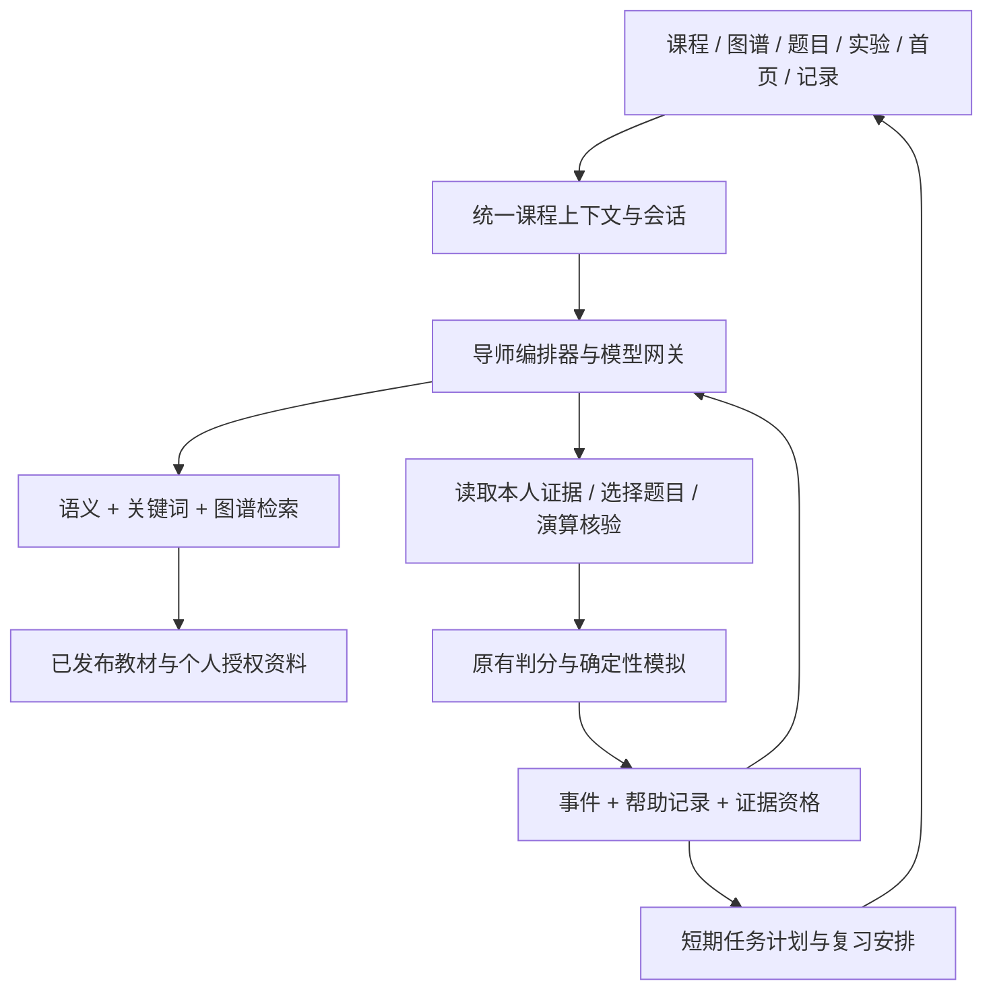

# ZhiCore 整体 AI 升级：双人使用 Agent，7 个工作日交付计划

版本：2026-11-02。本文是待实施计划，源码核对不等于部署验收；文中的新增接口、文件和能力均为开发目标。

## 1. 项目定位与交付结果

将现有 ZhiCore 升级为**能结合课程资料、题目、实验过程和个人学习证据，持续帮助学生学懂、发现不足、安排下一步的 AI 学习平台**。学习与复习贯穿原有课程流程，共用上下文、资料和记录。

学生进入课程可以继续学习，也可以提出“我只有 15 分钟，帮我复习”。平台根据已有证据安排阅读、解释、作答、预测或复测；学生卡住时回到对应资料和演算步骤，完成后继续原任务。学习与复习是当前目标和教学策略，不是两个独立开发的产品模块。

与直接打开通用 AI 工具相比，平台提供的价值是：自动带入当前课程和本人记录；发现“看过答案”和“能够完成新题”的差别；用题目或演算验证分析；把建议变成可以直接开始、可以追踪结果的下一步。

**第 7 个工作日交付：可启动的完整平台、两种真实模型配置、贯穿原页面的 AI 工作流、一个完整课程案例和一个跨课程验证案例，以及 8 分钟现场演示材料。**

执行条件：两名成员各自使用开发 Agent，每人投入 7 个完整工作日；第 1 天准备真实模型与 embedding 调用权限、可运行的现有环境及演示账号。每日联调，当天发现的问题当天进入共享清单。第 5 天结束冻结功能，第 6、7 天用于验证、修复和演示。

## 2. 已核对的基础与本次加强方向

以下为当前源码与内容文件的核对结果；演示机器上的导入、发布、服务和真实模型连接须在第 1 天另行验收。

| 已有基础 | 当前边界 | 本次升级 |
| --- | --- | --- |
| Vue 3 课程首页、单元、图谱、题目、实验、学习记录和悬浮助手 | AI 入口之间缺少统一、持久的学习任务上下文 | 各入口接入同一 AI 服务，保留课程、当前任务、资料引用和个人证据 |
| 图谱导师 GraphRAG | 关键词意图分类、一跳扩展、固定配额；教材片段按较简单方式选取 | 加入语义检索、关键词召回、关系约束、来源版本和可检查的工具轨迹 |
| 全局助手及导师模型调用 | 分别依赖全局 `ai.ark.*` 配置；部分提示词写死操作系统身份 | 抽取模型网关，支持个人配置；提示词由当前课程和任务生成 |
| 学习事件、BKT、推荐路径、首次作答及幂等逻辑 | 首次观测不等于未获得提示；看过答案后的表现需要区分 | 增加帮助记录与证据资格判断，先判断资格再提交掌握度更新 |
| 客观题服务端判分 | 综合题当前不自动评分 | 保留权威判分；AI 解释和诊断建议单独记录 |
| 页面置换纯计算器及预测判分接口 | 前端动画播放完成不构成能力证据；完整轨迹可能提前暴露答案 | AI 调用确定性工具核验，预测提交前只展示允许看到的前缀 |
| 课程目录、单元、内容发布与节点稳定编码 | 新课程须注册目录、章节和节点映射 | 使用同一内容协议增加一个小课程包，验证核心服务跨课程工作 |

主线内容取自现有页面置换包：**22 道题、7 个单元、11 个核验案例**。这表示文件存在，不表示演示数据库已经发布全部内容。平台没有已核实的递归题库；本计划不以递归、PV 或多线程题目作为已有演示条件。

## 3. 借鉴 DeepTutor 的机制

参考其当前官方文档：

- [DeepTutor 项目](https://github.com/HKUDS/DeepTutor)：围绕资料和学习工作区组织交互。
- [Mastery Path](https://docs.deeptutor.info/explore/mastery-path/)：目标、知识点、学习会话和复习关联；评估证据与学习者自我声明分开。
- [Practice](https://docs.deeptutor.info/explore/practice/)：先回忆再查看答案，记录复习结果和到期时间，能够回到资料补学。
- [Settings](https://docs.deeptutor.info/explore/settings/)：模型连接、能力检测、测试后应用配置，以及工作区资源作用域。

在本项目中的落地是：**课程作为工作区，现有页面作为操作入口，统一导师负责受约束的工具调用，资料与个人证据贯穿学习和复习。** 保留 Vue / Java 及现有课程、判题、图谱系统，借鉴这些机制实现，不迁移整套 DeepTutor。

DeepTutor 本身已有学习、复习、记忆和模型配置。答辩时明确参考来源，项目的实现重点放在现有课程与实验的整合、确定性核验、诊断验证及证据如何影响下一步。

## 4. 七天内必须完成的范围

| 编号 | 交付能力 | 演示可见结果 |
| --- | --- | --- |
| P0-1 | 统一课程上下文与持久会话 | 从单元进入题目、模拟、图谱再返回，导师知道当前课程、任务及本人已提交结果；刷新可继续 |
| P0-2 | 原有 GraphRAG 加强 | 回答综合教材、图谱与本人证据；引用可打开到具体段落、来源版本；检索与工具过程可查看 |
| P0-3 | 受约束的导师工具调用 | 根据问题调用检索、证据读取、已有题目选择、页面置换核验；工具结果决定建议 |
| P0-4 | 经过验证的薄弱点分析 | 错题后先提出可能原因，必要时用最多两道短题或一次预测区分；证据不足时保留不确定性 |
| P0-5 | 学习、复习贯通的下一步安排 | 同一课程可“继续学习”或“复习 15 分钟”；生成 3–5 个有原因、有入口的任务，卡住可补学后继续 |
| P0-6 | 可信的学习记录 | 区分无平台提示的作答、带提示作答、查看答案、自我评价；重复提交不重复增加掌握证据 |
| P0-7 | 用户自主配置模型 | 平台默认与个人配置均可用；测试通过再启用；切换模型后课程和记录保留 |
| P0-8 | 跨课程验证与完整演示 | 页面置换完整流程；新增数据库小课程使用同一套检索、问答、练习、复习和记录服务 |

P0 全部通过后才考虑扩展：PDF 自动解析、图片识题、语音、任意代码执行工具、多厂商原生协议、多角色专用模型、复杂长期规划、训练式知识追踪。七天内的资料补充入口支持粘贴文本和 UTF-8 Markdown / TXT，避免把解析兼容性变成主线依赖。

### 4.1 原有页面如何体现这次升级

| 页面或组件 | 本次改动 |
| --- | --- |
| 学习首页 `/home` | “继续当前任务”“按可用时间复习”及到期提醒；展示下一步理由与证据入口 |
| 课程单元 | 选中一段资料向导师提问；保留来源与段落锚点；可把补充文本加入当前课程的个人资料 |
| 节点工作台、图谱 | 复用导师面板；显示薄弱原因和证据，下一步直接导航到相应单元、题目或模拟 |
| 题目卡 | 提交后可请求分析；导师拿到服务端结果，选择核验题；已看答案的表现单独标识 |
| 现有模拟页 | 增加“先预测这一步”；提交前遮住后续轨迹，提交后高亮 AI 解释涉及的真实步骤 |
| 编程实验 | 现有“向导师提问”带入经授权的判题摘要、代码片段和事件 ID；系统错误不归为知识薄弱 |
| 学习记录 | 展示帮助情况、诊断依据、复测和下次复习；点击可回到当时的任务与资料版本 |
| 全局 AI 助手 | 统一模型设置、持久任务上下文、资料引用和下一步卡片；跨页面继续同一课程会话 |

主线复用现有题卡、模拟和助手，只增加公共上下文、资料引用、工具轨迹、下一步卡片等组件。编程实验的自动诊断深度由已有真实判题证据决定，本次现场主案例使用可确定性核验的客观题与模拟预测。

## 5. AI 技术设计与可展示的难点



### 5.1 统一上下文与可恢复记忆

上下文至少包括：`courseCode`、`unitCode`、`nodeCodes`、当前题目或实验、本人事件引用、所选资料、当前目标、时间预算、会话 ID 和模型配置 ID。浏览器传定位标识，后端校验归属并重新读取授权数据，不相信前端提供的正确率、掌握度和判题结论。

记忆分三层：最近若干轮对话；持久化的当前目标与任务位置；可追溯的学习事件和资料引用。摘要只用于压缩对话，不能替代原始成绩。切换模型仍使用这些平台数据。切换课程须切换会话作用域，避免把操作系统的错误带到数据库诊断中。

对尚未学过的知识，导师从已发布课程提取一个可完成的小目标，例如“能说明 LRU 的更新规则，并预测一次换出”。先展示建议路线，学生确认后按“一个概念或示例—一次尝试—反馈与调整”推进，允许随时提问、跳回资料或暂停。没有历史证据时标记“待确认”，可邀请学生完成 1–3 个短任务了解起点，不自动判为薄弱。

对复习目标，同一服务从历史与到期事项选择活动，优先让学生尝试回忆，再补解释。两种目标共享任务状态与证据；规划只引用实际存在、可访问的单元和活动。先完成一次短计划，再根据结果调整，避免生成一份无法落实的长篇学习路线。

### 5.2 GraphRAG 从“找到一些节点”升级为联合检索

1. 从当前课程的已发布资料和本人授权文本生成段落块，保存来源、修订、章节、节点映射及锚点。
2. 并行进行语义与关键词召回；图谱提供前置、相关和当前节点约束。先限制课程与权限，再召回和排序。
3. 合并去重、排序，保留必要的定义、算法条件和完整示例；为本人事件和下一步建议预留配额。
4. 返回本次来源 ID，回答逐项引用。检查来源 ID 是否存在、修订和定位是否有效；用人工标注问句检查内容是否支持回答。

七天实现采用小语料方案：已发布正文加少量个人文本，演示语料控制在数百块；embedding 可保存在 MySQL 的索引表中，应用内计算相似度，无需增加向量数据库。记录 embedding 模型、维度、文本哈希和版本，增量重建；不能混用不同模型的向量。向量模型由平台维护，用户切换生成模型不触发全量重建。

第 1 天必须验证真实 embedding 服务。调用故障时可用关键词与图谱降级，并在界面标出；完整 P0 验收仍需展示真实语义召回。不能把降级路径包装成语义检索。

**技术证明：**用同一组标注问句，对比原有检索与升级检索的来源命中、课程隔离和引用定位，保留真实结果。

### 5.3 让 AI 用工具获取与核验信息

统一导师提供小范围工具集：

| 工具 | 输出及约束 |
| --- | --- |
| `retrieve_sources` | 课程和授权资料的片段、来源 ID、修订、检索依据 |
| `read_learning_evidence` | 本人相关作答、帮助情况、失败类型、复习历史；只读 |
| `select_verified_activity` | 从已发布且人工核验的题目/预测任务中选择；返回活动引用 |
| `check_page_trace` | 调用现有 `PageReplacer` 生成 FIFO / LRU / OPT 轨迹；P0 演示使用 FIFO / LRU |
| `propose_next_actions` | 返回符合时间、前置条件与内容可用性的建议，用户点击后才开始 |

原生工具调用可用时采用原生格式；其他兼容模型采用经过 schema 校验的结构化请求。每轮最多 3 次工具执行、最多 2 次模型调用；具体超时通过真实模型实测后冻结，候选目标为总等待 30 秒以内。结构不合法可修复一次，失败则返回有来源的规则结果和明确状态。

模型不直接写分数或掌握度。活动提交由用户触发，经过原有判分服务；模型生成的未审核题目不能作为正式评估证据。工具列表与会话权限由后端决定，课程资料被当作待学习内容，不作为改变系统行为的指令。

轨迹面板展示真实工具名称、耗时、来源与核验结论，不展示或编造模型内部思维链。

### 5.4 从解释错误，走向区分错误原因

先为主案例人工建立“知识点—题目—常见误区—区分任务”映射。AI 结合选项与历史提出候选原因，再选择能区分这些原因的短任务。

例：三页框访问 `1, 2, 3, 1, 4`，最后应换出哪一页？FIFO 为 `1`，LRU 为 `2`，均为 4 次缺页、1 次换出。这个例子作为**新增并人工核验的诊断活动**，不冒充已有题目。

- 学生选错换出页，可能混淆 FIFO 与 LRU，也可能漏掉命中后的更新。
- 先问命中是否改变顺序，再做不同序列的预测；答案由服务端计算器核对。
- 输出 `TENTATIVE / SUPPORTED / INSUFFICIENT`，附支持和冲突事件。一次错误不能直接断言唯一原因。
- 学习解释之后使用未揭示答案的新任务复测。复测通过可以展示为“本次复测通过”，是否达到原有掌握标准仍由证据规则决定。

通用部分是候选原因、区分任务、证据合并与下一步；课程包提供知识点映射和任务。页面演算核验是可选课程工具，不是整个引擎的必要前提。

### 5.5 帮助记录与掌握证据

沿用现有首次评估身份和幂等机制，额外记录当前评估任务的 `NONE / HINT / ANSWER_REVEALED`、平台帮助事件、自报外部帮助、题目修订和来源事件。历史记录缺少帮助信息时标为 `UNKNOWN`，不倒推成未获得帮助；保留历史事件及快照，新增规则从上线后开始生效。普通的前置学习不等于当前题目获得提示；资格判断以当前任务范围为准。

关键规则：

- 首次作答与未获得帮助分开。平台只能确认平台内提示及用户自报，不能声称知道学生没有使用任何外部 AI。
- 提示或答案揭示必须在答题事务前被记录并参与证据资格判断，不能先更新 BKT 再补标签。帮助与提交按活动加锁或版本校验，处理两者并发发生的情况。
- 同一道题重复提交保留练习与复习结果，不能通过刷新、换会话或换模型反复增加首次观测。
- 自我评价影响复习安排，不能直接当作判分正确或独立能力证据。
- 综合题未自动评分、编译/服务故障、仅播放动画等情况不能伪装成通过评估。
- 保留 BKT 现有公式与阈值；其参数尚非本项目训练校准结果，不宣传精确预测学习效果。

### 5.6 学习与复习共享的短期规划

复用现有路径和前置关系，每次安排 3–5 个任务，按学生可用时间截断。任务类型包括读具体段落、回答一题、预测一步、解释区别、完成一次复测。

选择依据：已验证的近期错误、到期复习、目标覆盖、前置不足与证据缺失。每个任务显示“为什么现在做”“预计多久”“做完看什么结果”。证据未知显示“待确认”，不能全部判为薄弱。时间估算与排序权重是可配置启发规则，不包装成训练过的最优策略。

复习先作答或回忆，再展示答案；错了可直接打开对应资料和模拟，补学后返回剩余任务。七天版本采用可解释的 1 / 3 / 7 天阶梯安排，依据实际判分、提示与自评调整。保持长期 BKT 状态与复习到期状态独立，避免答对一道重复题就把知识点刷成掌握。

### 5.7 模型配置与可观察性

配置项为名称、服务类型、Base URL、模型名称、API Key；保留平台默认配置，支持个人的兼容接口。候选配置先进行真实调用和能力测试，通过后启用；无效候选不覆盖原配置。七天验收至少两个真实生成模型配置，其中一个是个人配置，不要求接入所有厂商的原生协议。

聊天、结构化输出和原生工具能力分别记录；不支持原生工具但结构化输出可用的模型走受约束协议。模型切换只改变后续推理，保持课程、资料、任务与证据。旧的全局助手和图谱导师都通过网关调用，避免新增入口能配置而原入口仍使用另一套模型。

密钥在后端加密保存，主密钥由环境配置提供；浏览器只收到脱敏信息，不放入 localStorage、提示词或日志。自定义地址校验协议及解析目标，阻止访问部署机器的内部服务；确有本地模型需求时由部署配置显式放行。

每轮保存模型标识、调用状态、来源 ID、工具摘要、耗时和可获得的 token 用量。价格未知时只记用量，不编造费用。

## 6. 两人和开发 Agent 的协作边界

这里的 Agent 指两位开发者使用的编码 Agent；平台运行时采用上一节的小规模导师编排器。由两人分别审查自己的 Agent 产物，并交叉验收关键链路。

| 负责人 | 所有权与任务 | 主要交付 |
| --- | --- | --- |
| 成员 A + 开发 Agent A | 课程上下文、资料接入、检索与引用；原页面集成；跨课程内容；公共契约和最终集成 | GraphRAG 检索服务、资料索引、公共上下文、助手/课程/图谱/题卡/模拟/记录的接入、内容包 |
| 成员 B + 开发 Agent B | 模型网关、导师编排、证据资格、诊断、下一步与复习；模型设置和任务卡叶组件 | 真实模型与 embedding 客户端、工具注册、学习证据、诊断流程、复习安排、测试及启动验收 |

### 6.1 文件边界与合并规则

- A 负责 `src/composables/useAiPageContext.ts`、`useAiConversation.ts`、原有页面和助手容器的集成修改；B 提供模型设置、诊断结果、下一步等独立组件，A 嵌入。
- A 负责公共接口类型与 DTO 契约、资料索引及检索实现；B 根据冻结契约实现模型、编排和证据服务。`LearningTutorServiceImpl`、`ChatController` 的网关和编排接入统一由 B 修改，A 提供检索接口。
- 现有 `LearningQuestionServiceImpl`、`LearningEventServiceImpl`、掌握度更新入口只由 B 修改，提交事务与幂等的变更必须有针对性回归测试。
- 数据迁移预留 `v11` 给 A 的会话/资料/索引，`v12` 给 B 的模型/证据/复习；若实施时号码已被占用，先重新分配。最终初始化脚本与 README 由 A 顺序接入两份迁移。
- 建议使用隔离 worktree 和 `codex/ai-context-retrieval`、`codex/ai-evidence-tutor` 两个分支，共同从已确认基线开始。保留仓库现有未跟踪文件，不将别的任务产物批量带入。
- 每天中午对接口、傍晚合入主集成线；D3 开始必须在同一启动环境验收完整流程。契约调整先更新说明和样例，再改调用方。
- 每次交付写明修改文件、已完成能力、实际检查结果、未解决问题和下一依赖；不能仅以“代码已生成”作为完成。

### 6.2 第 1 天冻结的契约

API 沿用 `BaseResponse { code, data, message }` 与既有登录鉴权。新契约中的数据库长整型 ID 使用字符串；新增时间带明确时区，兼容旧接口的本地时间转换，不能在本次升级中默默改变旧契约。

公共对象：

| 对象 | 必需字段 |
| --- | --- |
| `AiCourseContext` | `courseCode, unitCode?, nodeCodes[], resourceRef?, eventIds[], selectedSourceIds[]` |
| `AiSession` | `sessionId, courseCode, goal, focus(LEARN/REVIEW), timeBudgetMinutes, currentAction, modelProfileId, rowVersion` |
| `SourceRef` | `sourceId, ownerScope, courseCode, revision, blockId, locator, excerpt` |
| `EvidenceSnapshot` | `eventIds, skillCode, result, helpLevel, selfReportedHelp, eligibleForObservation, eligibilityReason` |
| `NextAction` | `actionId, type, targetRef, reason, evidenceIds, estimatedMinutes, status, returnRef` |
| `Diagnosis` | `hypotheses[], status, supportingEventIds[], conflictingEventIds[], verificationActionIds[]` |

核心内部接口：A 提供 `retrieveSources(scope, query)` 和 `resolveCourseContext(user, refs)`；B 提供 `ModelGateway`、`EmbeddingClient`、`readEvidence`、`diagnose`、`planNextActions`。工具注册只绑定这些接口，避免两人分别实现一套上下文与检索。

新增接口建议如下，均为**待实现**，表内路径相对于后端上下文 `/api`：

| 接口组 | 最小接口及职责 |
| --- | --- |
| 会话 | `POST /learning/ai/sessions`、`GET /learning/ai/sessions/{id}`、`PATCH /learning/ai/sessions/{id}`：创建、恢复、修改目标/重点/模型，写操作带版本 |
| 导师轮次 | `POST /learning/ai/sessions/{id}/turns`、`GET /learning/ai/turns/{turnId}`：请求带 `clientRequestId`；返回执行状态、来源、工具轨迹和下一步 |
| 活动执行 | `POST /learning/ai/actions/{id}/start`、`POST /learning/ai/actions/{id}/submit`：校验当前用户与资源修订，委托原判分服务，使用 `submissionKey` 幂等 |
| 下一步 | `GET /learning/ai/next-actions?courseCode=...`：首页、图谱、导师共用；会话目标可触发短期计划更新 |
| 资料 | `POST /learning/ai/materials`：个人文本/Markdown 接入、限量、按课程隔离；读取和删除须校验所有者 |
| 模型 | `GET/POST /ai/model-profiles`、`POST /ai/model-profiles/test`、`PATCH /ai/model-profiles/{id}`：脱敏读取、候选测试、保存和更新 |

保留 `/chat/ask` 和 `/learning/tutor/ask`，内部委托统一服务并维持旧响应兼容；新页面使用完整结构。不要出现“只有新页面使用升级后的 AI”的最终状态。

会话、轮次和动作需持久化。可采用有界执行线程池加状态查询，页面轮询至终态；进程重启后把未结束轮次标成可重试状态。相同请求返回同一轮次，重试不能重复提交活动。服务端校验所有操作归属及版本，过期上下文应刷新后再执行。

### 6.3 最小数据设计

复用现有课程、题目、作答、事件和掌握度表，新增表控制在以下范围；诊断、计划及任务列表允许先保存在会话/轮次的 JSON 中。

| 数据 | 内容 |
| --- | --- |
| `ai_learning_session` | 所有者、课程、目标、重点、任务位置、摘要、模型引用、计划 JSON、版本 |
| `ai_tutor_turn` | 请求幂等键、状态、回答、来源/工具/诊断 JSON、调用统计 |
| `ai_material` / `ai_material_chunk` | 个人或课程来源、修订、段落、节点映射、embedding 模型/维度/向量/哈希 |
| `ai_model_profile` | 所有者、服务地址、模型、加密凭据、能力与测试时间 |
| `learning_evidence_context` | 当前活动、作答/事件引用、帮助记录、资格及原因；事务前可确定 |
| `learning_review_item` | 所有者、课程、知识点/活动、来源事件、阶段、到期时间与状态 |

不复制现有判题与成绩为另一份事实源。课程误区映射采用版本化内容 JSON，先服务于人工核验的小内容集。

## 7. 七个工作日安排

以 D1–D7 表示连续工作日，不包含周末；每日安排约 6 小时实现、1 小时联调、1 小时审查与修复。若从 2026-11-02 开始且无额外假期，D7 为 2026-11-10。实际以双方确定的开工日为准。

| 日期 | A + Agent A | B + Agent B | 当日必须验收 |
| --- | --- | --- | --- |
| **D1：基线与契约** | 启动基线；核对页面置换内容是否发布；冻结上下文/来源/工具契约；原页面接入公共上下文骨架；梳理两课程内容 | 验证两个真实模型及 embedding；建立网关骨架；核对答题到 BKT 事务；冻结帮助与幂等规则 | 一页基线报告、契约样例、真实连接记录；课程切换传正确编码；确认可用题目/资料 ID |
| **D2：统一服务与检索** | 建立段落索引、语义/关键词/图谱联合检索；来源定位；会话持久化；助手容器接入新服务 | 完成个人模型配置/测试/切换；工具注册及轮次状态；旧助手/导师接入网关；帮助事件与判分资格集成 | 原入口真实模型回答并可打开引用；刷新恢复会话；带提示作答不误写掌握观测 |
| **D3：首条完整流程** | 课程→提问→题目→模拟→记录的导航与上下文接入；新增诊断活动核验 | 实现小目标引导学习、候选原因→区分任务→证据更新；接通 `PageReplacer` 核验；原题判分与预测答案隐藏 | 同一环境真实跑通一次“学习—错题—分析—核验—补学—新任务复测”；记录不得由前端伪造 |
| **D4：贯通复习与第二课程** | 首页/图谱接入下一步卡；资料补学返回原任务；注册并发布数据库小课程包 | 时间预算计划、到期队列、复习阶梯；共用学习证据；诊断/任务叶组件；切换模型后继续 | 同一课程可继续学习或做短期复习，错题可补学返回；数据库课程也能引用资料、作答并安排下一步 |
| **D5：整体集成与冻结** | 完成剩余原页面接入、引用及跨课程隔离；标注检索评价集并比较基线；修复交互 | 完成证据/事务/重复请求/模型能力异常回归；诊断案例评测；补齐调用用量与轨迹 | P0-1～P0-8 逐项过关；两个模型真实运行；晚间功能冻结，未完成项明确列为未交付 |
| **D6：验收与恢复** | 在演示机从停止状态启动；检查资料、种子和模型状态；清理断链、加载态和返回入口 | 跑构建与必要回归；检查超时、重启、鉴权及幂等；准备 smoke/状态导出与故障恢复 | 两轮完整彩排；能从启动脚本进入主线；发现问题只修复；输出可复查检查记录 |
| **D7：交叉验收与演示包** | 按脚本操作、录制备份、整理操作说明与架构图 | 对照清单独立验收、核对日志与真实调用、整理已知限制 | 连续三次 8 分钟演示通过；演示包、版本标识、真实指标、备用方案齐全 |

**每日决策：**D2 仍未完成真实模型和联合检索，不增加新功能；D3 未贯通完整流程，D4 先修主线；D5 未过 P0，D6、D7 修复剩余项，不能用录像或静态数据替代未完成能力。优先压缩扩展题量、资料格式和视觉细节，保留原入口整合、证据正确性和真实调用。

## 8. 内容与泛化验收

### 8.1 主课程：页面置换

七天内聚焦三个能力：区分缺页与换出；FIFO 命中不改变进入顺序；LRU 命中更新最近使用顺序。

优先复用以下 8 道现有题目，先核实其发布状态及绑定节点：

```text
q.self.replacement.free-frame
q.self.replacement.count-gap
q.self.compare.count-metrics
q.self.fifo.hit-order
q.self.lru.hit-update
q.self.lru.sixth-victim
q.self.lru.history
q.wd25.s3_2.050.adapt1
```

最多新增 4 个自编诊断/迁移活动，两人交叉复核题干、选项、答案及轨迹。新任务的评估身份与来源明确，不能给同一道题换名字来制造独立证据。原有 CLOCK 等材料保留，但不要求给后端计算器新增算法。

### 8.2 新课程包：数据库函数依赖与候选键

这是新增的泛化验证内容，不声称仓库已经具备。范围为 3 个知识点、3 段自编讲义、6 道经过复核的客观题，以及知识点—误区—活动映射。

知识点可选择属性闭包、超键与候选键、候选键最小性。题目答案人工按闭包法核验，沿用现有客观题评分，不增加 SQL 执行器。除内容文件外，必须完成 `course_catalog`、章节、节点与单元注册、发布和实际可访问验证。

验收：相同导师、检索、会话、题卡、诊断状态、下一步和复习服务能在新课程运行；提示词不再自称操作系统教师；不会混入其他课程记录。允许数据库课程使用普通客观题工具而不使用页面置换工具。

这证明两种不同课程内容能够复用核心流程；完整推广到任意学科仍需要内容、任务和适当的核验工具，答辩不夸大范围。

## 9. 必须通过的检查

以下为未来实现后的验收要求，本计划编写阶段没有运行这些新增能力。

| 类别 | 最小检查 |
| --- | --- |
| 原平台整合 | 全局助手、原图谱导师、题目、模拟、首页、记录均能访问同一课程会话或其任务/证据；旧入口仍可用 |
| 引用与检索 | 固定 20 条人工标注问句，覆盖同义表达、算法条件、当前错题和第二课程；目标 Top-5 来源命中至少 17/20，8 个主线关键问句全部命中；记录真实值 |
| 诊断 | 至少 8 条固定案例，包含知识混淆、计算失误、证据不足、已看答案及系统故障；检查原因有依据、核验任务有效、未知时不强判 |
| 判分与观测 | 原判分一致；帮助在事务前生效；重复请求、重复题、换会话、换模型不能刷观测；系统故障不降低知识掌握 |
| 状态恢复 | 刷新、页面跳转、模型切换、超时重试、服务重启后可解释地继续，不能重复提交或丢失已完成任务 |
| 范围隔离 | 不读取他人会话/资料/密钥；不混入另一课程、草稿/下线题或越权任务内容；学生未作答前不泄露答案 |
| 模型 | 两个真实配置通过；无效配置保留原可用选择；缺少工具能力有实际可用的结构化协议或明确不可用提示 |
| 跨课程 | 两课程均能资料问答、客观题提交、记录和下一步安排；数据库包真实注册发布 |
| 演示 | 本机停止后启动成功，关键引用与按钮无断链；连续三轮主线通过；所有回放和示例数据有标识 |

评价集在调参前冻结。检索只比较检索质量，不能据此声称学生成绩提高；短期试用可找 2–4 位同学，记录是否找到薄弱点、是否能完成下一步及实际耗时，不编造教学效果统计。

### 9.1 现有检查入口

仓库根目录：

```powershell
node scripts/validate-course-content.mjs
node scripts/validate-course-content.mjs --batch batches/memory-page-replacement-001.json
node scripts/verify-page-replacement-content.mjs
powershell -ExecutionPolicy Bypass -File ./start-oslab.ps1 -Status
```

在 `前端代码/osLab-frontend` 执行：

```powershell
npx vue-cli-service lint --no-fix
npm run build
Get-ChildItem tests/*.js | ForEach-Object { node $_.FullName; if ($LASTEXITCODE -ne 0) { exit 1 } }
```

在 `后端代码/osLab-backend` 执行：

```powershell
.\mvnw.cmd test
.\mvnw.cmd package -DskipTests
```

优先覆盖现有 `LearningTutorServiceTest`、`PublishedLearningContentServiceTest`、`LearningEventObservationTest`、`LearningQuestionAssessmentTest`、`LearningQuestionGraderTest`、`LearningPathServiceTest`、`PageReplacerTest` 和 `CourseContractsTest`。新增测试围绕权限、证据事务、模型失败、检索质量与恢复等实际风险，不为纯展示组件机械增加测试。

已有全链路脚本 `scripts/dev/verify-learning.ps1` 可辅助回归；其 sandbox stub 只能证明接口链路，不能作为真实代码判题验收。本次主线不依赖任意代码执行；若现场展示代码判题，必须另有真实沙箱运行证据。Docker 是否可用以演示机实测为准，优先复用已经可运行的原生 Windows 启动方式。

## 10. 八分钟现场演示脚本

使用专用演示账号。到期复习优先使用 D3–D6 彩排留下的真实历史；若使用预置数据，界面和讲解明确注明演示样例，不修改系统时间冒充学习跨度。

| 时间 | 操作 | 要证明的能力 |
| --- | --- | --- |
| 0:00–0:40 | 从原首页进入课程，展示当前任务和待复习项 | 原平台已贯通，任务有个人证据来源 |
| 0:40–1:40 | 在课程资料中询问“为什么这里命中后换出的页不同”，打开引用与检索轨迹 | 增强 GraphRAG、来源定位及课程上下文 |
| 1:40–3:15 | 做一道题，主动选一个预定错误选项，点击分析；完成短核验或模拟预测 | 分数来自服务端，AI 原因通过真实任务验证 |
| 3:15–4:20 | 跳到原模拟页，提交前预测，提交后看差异步骤；回到学习任务 | 确定性工具核验、跨页面持续上下文 |
| 4:20–5:30 | 提出“我有 15 分钟复习”，展示 3–5 个任务；进入补学，再返回未完成队列 | 学习和复习共用记录、时间约束与可执行建议 |
| 5:30–6:20 | 完成一项新任务复测，打开学习记录查看帮助和证据状态 | 区分理解表现、提示表现与重复练习 |
| 6:20–6:55 | 切换到第二个已测试的真实模型，继续当前任务 | 用户配置生效，平台状态不依赖单一模型 |
| 6:55–7:40 | 切换数据库小课程，提问并打开对应题目或下一步 | 核心能力跨课程复用 |
| 7:40–8:00 | 打开一次真实调用的工具、来源和耗时摘要 | 技术实现可检查，展示过程可复现 |

演示机预先准备好资料与 embedding 索引、登录状态和已测试模型；现场可以切换模型并发起真实请求，无需把网络连通测试和密钥输入作为主线。演示讲解只描述实际得到的结果。

### 10.1 故障恢复

- 模型超时：保存任务位置和已提交结果，显示失败，允许重试；规则判分、资料和既有记录继续可用。备用模型切换必须可见，不能悄悄替换。
- embedding 临时失败：使用已完成的索引；缺少可用索引时标注降级为关键词/图谱路径，不虚报联合检索成功。
- 页面刷新或服务重启：恢复持久会话；未完成轮次显示可重试，已有作答按幂等键返回同一结果。
- 全部外部模型不可用：展示可检查的已保存调用记录或备用录像，并明确为历史回放；不能将其当作现场真实调用通过。
- 数据恢复仅操作专用演示账号和明确标识的数据，不清空现有课程、题库与其他用户记录。

## 11. 可以直接交给两条开发 Agent 的任务书

### Agent A：课程上下文、检索与全站整合

> 在现有 ZhiCore 上实施本计划。先核对现有发布数据和运行环境，D1 与 B 冻结公共契约。负责课程作用域、持久会话、资料段落和来源定位、语义/关键词/图谱联合检索，以及原有首页、课程、图谱、题卡、模拟、学习记录和助手的公共组件接入。调用 B 提供的模型、证据与规划接口，不自行实现另一套判分、模型网关或学习记忆。主案例复用页面置换已发布内容，新增数据库小课程完成真实注册发布。按日提供可运行增量、检查结果和契约变更。D3 跑通主线，D5 冻结功能。不得以新的独立学习/复习页面替代原有入口的整合，不宣称文件存在即已发布。保留现有无关改动，不自行提交、推送或部署。

### Agent B：模型、导师编排与学习证据

> 在相同基线上实施本计划。负责统一模型网关与 embedding 客户端、用户模型测试和配置、受约束工具编排、帮助记录和证据资格、诊断验证、短期任务及到期复习。复用 A 的课程与来源接口，保持旧助手和图谱导师的兼容接入。修改答题到 BKT 事务前先写有意义的回归测试，避免重复请求、提示后作答和系统故障污染掌握状态。用真实模型与确定性工具完成主线，不使用模拟 AI 回复代替验收。模型设置和任务结果组件独立交付给 A 集成。D2 完成真实连接，D3 贯通诊断与复测，D5 冻结功能。保留现有无关改动，不自行提交、推送或部署。

两人交叉检查重点：A 审核 B 的判分/证据是否影响原有行为；B 审核 A 的检索权限、跨课程边界和原页面是否真的接入。执行过程中可以让 Agent 做只读审查，但关键验收由两人实际操作和检查结果确认。

## 12. 最终交付包与比赛表达

第 7 天交付以下可复查材料：

1. 可启动版本及明确的代码版本/变更清单；迁移顺序、环境模板、模型配置说明。
2. 实际接口契约、演示课程/题目/资料版本与账号准备清单；不包含密钥。
3. 页面置换与数据库内容包、人工核验记录、检索评价与诊断案例真实结果。
4. 自动检查日志、主线 smoke 结果、两种模型的脱敏调用与用量记录、已知限制。
5. 8 分钟演示脚本、简短操作说明、备用录像及故障恢复步骤。

计划新增 `scripts/dev/prepare-ai-demo.ps1` 和 `scripts/dev/smoke-ai-demo.ps1`，分别负责检查/准备演示数据与执行关键链路；状态与结果写到 `artifacts/ai-platform-demo/`。脚本应保护非演示数据，不能记录密钥。它们目前尚未实现。

依据用户提供的赛道截图，可将对应关系讲清楚：

| 赛道关注点 | 本项目的实现与证据 |
| --- | --- |
| 前端工程与体验 | 现有 Vue 平台贯通课程、题目、模拟、图谱和记录；共享上下文、异步状态及任务恢复 |
| AI 深度集成 | 联合检索、受约束工具调用、模型网关、结构化诊断及证据驱动任务选择 |
| 真实应用价值 | 学生少搬运上下文，薄弱点通过任务核验，复习建议能直接执行并保留结果 |
| 创新与可解释性 | 学习与复习共用证据；AI 分析接确定性工具；提示表现与能力观测分开 |
| 泛化能力 | 两个真实课程包复用同一核心引擎，课程特有工具按能力注册 |

答辩主张：**“把原有课程、题目、实验与图谱连接成可验证的 AI 学习流程：知道学生正在学什么，帮助确认卡在哪里，并把下一步落到可执行、可追踪的活动。”**

## 附：已核对的实现入口

- [平台 README](E:/web/web/源程序（包含数据库）/README.md)：现有能力、启动与验证方式。
- [现有图谱导师](E:/web/web/源程序（包含数据库）/后端代码/osLab-backend/src/main/java/com/yupi/springbootinit/service/impl/LearningTutorServiceImpl.java)、[全局助手接口](E:/web/web/源程序（包含数据库）/后端代码/osLab-backend/src/main/java/com/yupi/springbootinit/controller/ChatController.java)：统一 AI 服务的接入点。
- [教材检索](E:/web/web/源程序（包含数据库）/后端代码/osLab-backend/src/main/java/com/yupi/springbootinit/learning/PublishedLearningContentService.java)、[课程导入](E:/web/web/源程序（包含数据库）/后端代码/osLab-backend/src/main/java/com/yupi/springbootinit/course/CourseContentService.java)：资料与跨课程基础。
- [题目判分服务](E:/web/web/源程序（包含数据库）/后端代码/osLab-backend/src/main/java/com/yupi/springbootinit/service/impl/LearningQuestionServiceImpl.java)、[学习事件服务](E:/web/web/源程序（包含数据库）/后端代码/osLab-backend/src/main/java/com/yupi/springbootinit/service/impl/LearningEventServiceImpl.java)：事务、幂等和观测资格的修改重点。
- [页面置换核验器](E:/web/web/源程序（包含数据库）/后端代码/osLab-backend/src/main/java/com/yupi/springbootinit/learning/PageReplacer.java)：确定性演算工具。
- [页面上下文](E:/web/web/源程序（包含数据库）/前端代码/osLab-frontend/src/composables/useAiPageContext.ts)、[助手会话](E:/web/web/源程序（包含数据库）/前端代码/osLab-frontend/src/composables/useAiConversation.ts)：当前上下文与会话升级起点。
- [页面置换内容说明](E:/web/web/源程序（包含数据库）/content/operating-systems/wangdao-2025/README.md)、[现有题目包](E:/web/web/源程序（包含数据库）/content/operating-systems/wangdao-2025/questions/a-memory-page-replacement-001.json)：演示内容依据。
