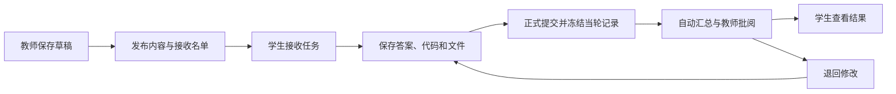

# 教师端内容管理与学习任务执行计划

更新：2026-10-20  
执行对象：L 与实施 agent  
文档性质：独立的功能实施计划。本次只制定计划，文中的新增页面、接口与数据表均为待实施设计，不代表已经上线。  
关联文档：`docs/教材驱动课程重构/17-课程学习整合与第一章交付执行计划.md`、`18-demand2人工反馈修正计划.md`。两份计划中的课程与模拟器修正继续有效，本文件不替代它们。

## 1. 要交付的结果

让教师可以在平台内维护教学内容、布置学习任务，让学生从独立入口接收和完成任务。交付必须覆盖以下完整流程：

1. 教师找到题目、编程实验、知识节点、学习单元的列表与编辑入口，使用表单修改内容并按既有发布规则生效。
2. 教师创建学习任务，组合文字、资料文件、题目、编程实验；既能选择资源库内容，也能自行编写仅用于本任务的题目和实验。
3. 教师选择班级或具体学生，预览接收人数后发布。学生登录后能看到任务，主动接收，保存进度，再正式提交。
4. 平台自动评判客观题与具备测试用例的代码实验；教师能查看文字、文件和实验结果，给出分数、评语或退回修改。
5. 任务内真实的作答与代码判题继续进入数字孪生和掌握证据；任务接收、文件下载和点击完成不被当作知识掌握。

一级导航新增“学习任务”，与“课程学习”“题目练习”“实验中心”并列。题目练习、算法模拟、编程实验三个原有独立入口继续保留。

本轮沿用 Vue 3、Arco Design、Spring Boot、MySQL、现有登录权限、代码沙箱和图谱同步机制。文件默认保存在服务器私有目录，不要求引入新的云服务、消息队列或 Office 在线转换服务。

## 2. 已核对的项目基线

以下是制定本计划时核对源码得到的事实。实施时先检查相关文件是否已被其他工作修改，再接续现有实现。

| 范围 | 当前实现 | 本轮改造重点 |
| --- | --- | --- |
| 教师身份 | `UserRoleEnum` 只有 `user/admin/ban`；`LearningTeacherController` 明确使用管理员承载教师能力。 | 本轮继续以 ADMIN 使用教师端，不直接新增一个无法被现有鉴权正确识别的 teacher 字符串。 |
| 班级与学生 | `students` 有 `className/studentNumber/userId`，`GET /learning/teacher/classes` 可获取班级；没有独立的授课班级关系表。 | 复用现有名单发布任务；不为本功能再建一套学生名册。 |
| 题目编辑 | `ManageLearningQuestionsView.vue` 已有编辑表单；旧 CRUD 与 `TeachingAssessmentService` 的稳定代码、草稿修订体系并存。 | 对齐题目编辑与发布入口，不能让某个按钮绕过修订直接覆盖已发布内容。 |
| 实验编辑 | `AddQuestionView.vue` 经旧 `/question/update` 直接修改实验；`ExperimentMaintenanceService` 另有修订、审核和 APPLY 流程。后者以已有 `questionId` 为前提。 | 收口为一条维护链路，并补齐全新实验的草稿创建能力。 |
| 节点编辑 | `CourseTeachingController` 有节点 GET/PUT；PUT 把节点包装为知识包提交，但构造的 `relations` 数组为空。 | 基础信息可以复用；不能把关系表单接到现有 PUT 后就宣称关系编辑成功。 |
| 学习单元 | 已有目录、单元 GET/PUT、修订与发布；教师页仍包含较多 JSON 编辑。 | 提供教师可直接使用的单元表单与显式入口，保留已发布快照机制。 |
| 任务系统 | 本次核对的当前模块中没有教师布置、学生接收、任务批阅的完整模型。测评会话属于自主练习。 | 新建任务域；不把测评会话或学习单元强行改名为任务。 |
| 作答与判题 | `learning_attempt` 保存题目快照；`question_submit` 关联 `questionId`，判题服务读取对应实验记录。 | 任务执行复用这两条链路，但必须绑定任务上下文与冻结内容。 |
| 学习证据 | `LearningEventServiceImpl` 已负责作答、代码判题、模拟练习事件与掌握更新。 | 扩展来源字段和映射读取，不另建一套掌握度。 |
| 文件 | `/file/upload` 当前主要服务头像，限制约 1 MB 并走 COS；课程附件下载也有自己的发布可见性规则。 | 新增任务附件上传下载，不能直接把头像接口当作 doc/docx 接口。 |
| 数据库迁移 | 当前目录已到 `oslab_upgrade_v7_identity.sql`。 | 本轮拟新增 v8；实施时如编号被占用，顺延并更新交付文档。 |

### 2.1 主要源码位置

为控制文档长度，以下约定：

- `F`：`前端代码/osLab-frontend/src`。
- `B`：`后端代码/osLab-backend/src/main/java/com/yupi/springbootinit`。

实施前需要阅读与当前步骤相关的文件：

| 主题 | 文件 |
| --- | --- |
| 导航与布局 | `F/navigation/appNavigation.ts`、`F/router/routes.ts`、现有 `LearningLayout` 与 `TeachingLayout`、`F/styles/learning-theme.css` |
| 教师内容页 | `F/views/learning/ManageCourseContentView.vue`、`ManageLearningQuestionsView.vue`、`F/components/learning/CourseRegistryEditor.vue` |
| 实验页 | `F/views/question/ManageQuestionView.vue`、`AddQuestionView.vue`、`ViewQuestionView.vue` |
| 学生题卡 | `F/components/learning/QuestionAnswerCard.vue`、`F/views/learning/AssessmentRunView.vue`、`F/api/learning.ts` |
| 身份与名单 | `B/model/enums/UserRoleEnum.java`、`B/aop/AuthInterceptor.java`、`B/controller/LearningTeacherController.java`、`StudentsController.java`、`B/service/impl/LearningTeacherServiceImpl.java` |
| 内容维护 | `B/course/CourseTeachingController.java`、`CourseContentService.java`、`B/learning/TeachingAssessmentService.java`、`ExperimentMaintenanceService.java`、`B/controller/TeachingResourceImportController.java` |
| 执行与证据 | `B/service/impl/LearningQuestionServiceImpl.java`、`QuestionSubmitServiceImpl.java`、`LearningEventServiceImpl.java`、`B/judge/JudgeServiceImpl.java`、`B/learning/ActivityContextService.java` |
| 文件与事务 | `B/controller/FileController.java`、`B/course/CourseController.java`、`B/config/LearningTransactionConfig.java`、后端 `application.yml` |

## 3. 产品与页面设计

### 3.1 导航与角色

顶栏顺序建议为：首页、课程学习、题目练习、实验中心、学习任务、学习资源、教学管理。教学管理继续仅 ADMIN 可见。

- 学生点击“学习任务”进入 `/tasks`，显示分配给自己的任务。
- ADMIN 点击同一一级导航进入 `/teaching/tasks`，显示自己布置的任务；教学管理侧栏也有“学习任务”入口，指向同一页面。
- 一级导航只维护一份 `tasks` 配置，按角色解析目标地址；不复制两份同名一级菜单。
- `/tasks/*` 和 `/teaching/tasks/*` 的 `navKey` 均为 `tasks`。`TeachingLayout` 内的菜单定位单独处理，不能出现顶栏两个条目同时选中。
- 学生首页增加简洁的待接收、待提交任务入口；数量由接口返回，不使用前端模拟数字。

拟新增路由：

| 路由 | 使用者 | 页面用途 |
| --- | --- | --- |
| `/tasks` | 学生 | 我的学习任务 |
| `/tasks/:taskCode` | 任务接收学生 | 任务详情、接收、作答、上传、正式提交与反馈 |
| `/teaching/tasks` | ADMIN | 我发布的任务及完成情况 |
| `/teaching/tasks/new` | ADMIN | 创建草稿 |
| `/teaching/tasks/:taskCode/edit` | 创建者 | 编辑草稿，或管理发布后的允许变更 |
| `/teaching/tasks/:taskCode/review` | 创建者 | 学生列表、提交详情与批阅 |

编辑与批阅页使用现有教师布局。学生任务详情使用学习布局，主内容区给题卡和代码编辑器足够宽度，不叠加两层侧栏。

### 3.2 教师内容管理入口

教学管理侧栏明确列出：内容总览、题目管理、编程实验管理、知识节点与关系、学习单元、学习任务、班级分析、用户管理。

旧 `/teaching/assessments`、`/teaching/experiments`、`/teaching/knowledge`、`/teaching/content` 保留兼容，不制造第二套数据。内容总览展示四类资源的数量、搜索与“新建/编辑”，不再要求教师先理解资源包和 JSON 才能操作。

各类内容的最低编辑能力：

| 对象 | 表单字段与操作 | 生效方式 |
| --- | --- | --- |
| 题目 | 标题、题干、单选/多选/判断/填空、选项、答案、解析、难度、来源、所属小节、PRIMARY/SECONDARY 节点映射；保存、预览、提交、发布/下线 | 复用 `TeachingAssessmentService` 的修订与发布逻辑，稳定 `questionCode` 不随标题改变 |
| 编程实验 | 标题、实验说明、输入输出、样例、初始代码、参考解、支持语言、测试用例、时间/内存限制、节点与单元映射；新建、编辑、预览与应用修订 | 统一进入维护服务，保留原实验 ID、历史提交与映射；全新实验先存草稿 |
| 知识节点 | `nodeCode`、名称、别名、类型、定义、归属小节、来源；关联教学块入口；前置/包含/相关/实现关系 | 通过 MySQL 稳定注册表及现有图谱同步写入，展示实际同步状态 |
| 学习单元 | `unitCode`、标题、课程与小节、排序、目标、教学/先修节点、教学块、题目/实验/模拟活动、必做项与完成规则 | 沿用单元修订与发布快照，不因保存草稿就改变学生正在学习的版本 |

基础信息、关系、教学块、映射分别表达，避免把“编辑节点”误解为编辑一整篇讲义。JSON 编辑可放在高级折叠区，但不能是唯一编辑方式。

编辑入口除管理列表外，还应出现在管理员查看节点详情、单元详情和实验详情的位置。学生页面不显示这些入口；后端同时校验权限。

### 3.3 教师任务列表与编辑器

任务列表使用清晰的表格，列出：标题、发布对象、截止时间、状态、接收人数、已提交人数、待批阅人数和操作。筛选保留标题、状态、班级；默认只显示自己创建的任务。

编辑页采用以下四个区域，较短任务无需走四个独立页面：

1. **基本信息**：标题、说明、关联课程/单元（可选）、截止时间（可选）、是否允许逾期提交。
2. **任务内容**：可排序的内容块，添加文字、资料、题目、编程实验。
3. **发布对象**：选择一个或多个现有班级，也可按姓名/学号选择具体学生；展示去重后的有效人数与未绑定账号人数。
4. **学生视角预览**：展示真实题干、资料、分值和提交要求；答案、解析、隐藏用例不出现在学生预览中。

每个题目/实验块有“从资源库选择”和“自行编写”两个来源选项。选择资源后可“复制后修改为本任务内容”，该动作只修改任务草稿，不修改资源库原件。资源库本身的编辑在对应管理页完成。

页面主操作保持“保存草稿”“预览”“发布任务”。发布任务不额外增加一轮审批。

### 3.4 学生任务列表与任务页

学生列表按待接收、进行中、已提交、已批阅分类，可附加逾期标记。卡片或列表显示标题、布置教师、截止时间、任务组成和当前状态。

任务详情：

- 顶部说明发布教师、截止时间、提交状态；待接收时主按钮为“接收任务”。阅读详情不等于接收。
- 内容按教师顺序展示；文字和资料直接阅读，题目就地作答，代码实验打开带任务上下文的编辑区。
- 长任务使用内容锚点；文字、题目、实验区域不要各自再生成一套课程目录。
- 每个可提交部分显示保存状态；刷新后能恢复已保存答案、代码和文件。
- 底部固定或就近展示“保存进度”“提交任务”；正式提交前列出未完成必做项与正在判题的项。
- 提交后显示提交时间、当轮记录、自动结果及待教师批阅提示；教师退回时显示原因和“继续修改”。
- 学生能查看本人的历次正式提交与教师反馈，不能看到其他学生的答案或文件。

视觉沿用已经确认的浅色、克制蓝色、细边框与现有主题变量。增加实用编辑器和列表即可，不进行品牌重做，不添加装饰性大屏。

## 4. 任务内容与业务规则

### 4.1 内容块类型

| `itemType` | 内容 | 学生动作 | 判定方式 |
| --- | --- | --- | --- |
| `TEXT` | Markdown 文字说明；可要求文字答复与文件回传 | 阅读、填写答复、按要求上传 | 无答复要求时正式提交视为确认；有答复要求时验证必填，由教师批阅 |
| `MATERIAL` | 一个或多个资料文件，可附阅读说明 | 下载；可配置阅读后确认或提交作业文件 | 下载不自动完成；按配置确认或提交，教师可批阅 |
| `QUESTION` | 单选、多选、判断、填空 | 填写答案并检查/保存 | 复用现有服务端判分；当轮最后一次有效作答用于正式提交 |
| `EXPERIMENT` | 具备测试用例的代码实验，或明确标注人工评阅的实践任务 | 编码判题，或上传报告/填写说明 | 自动实验取服务端判题结果；报告实验由教师批阅 |

每块都有稳定 `itemCode`、排序、`required`、分值 `maxScore` 和提交要求。文件可附在上述各类内容中，不把“有文件”强制等同于一种实验。

支持纯文字任务、纯文件任务、只含题目的任务、只含实验的任务和混合任务。无需关联知识节点或学习单元，也可以正常发布文字/文件任务。

自动代码实验必须有有效用例、限制和至少一种支持语言；没有用例时只能明确选择人工评阅模式，不能显示虚假的“测试通过”。知识节点映射可以不填，但不填就不更新节点掌握度。

### 4.2 与课程、节点和资源库的关系

- 学习单元是课程的教学编排，学习任务是教师向一组学生布置的工作，二者是不同对象。
- 任务可关联课程和单元，用于筛选和返回上下文；该关联不自动改写单元活动，也不把整个单元标为完成。
- 题目和实验仍关联稳定 `nodeCode`；任务发布时保留映射快照。任务内行为以该快照产生掌握证据。
- 独立入口的历史完成记录不自动抵扣新任务；本轮只认学生接收任务后、在该任务执行上下文中产生的记录。
- 从任务中打开算法演示，可作为关联学习资料；本轮不再增加第五套模拟任务协议。确需提交报告时使用文字/文件块，既有模拟练习能力保持不变。

### 4.3 状态与发布后编辑

任务状态只使用 `DRAFT → PUBLISHED → CLOSED`，归档为独立布尔标记。

- 草稿：可修改全部内容、接收对象与规则，也可删除。
- 发布：冻结任务内容、分值、完成规则、题目/实验执行数据与初始接收名单。
- 发布后：可延长截止时间、追加说明、显式追加接收学生、关闭和归档。已公布的题干、答案、测试用例、分值和必做规则需要调整时，使用“复制为新任务”编辑发布，不改变学生已经作答的依据。
- 关闭：停止新接收、修改答案与正式提交；仍允许查看历史、下载原资料和批阅已提交内容。
- 截止时间本身不关闭任务；`allowLate=true` 时可逾期提交并标注逾期，`false` 时截止后停止提交。
- 教师退回修改时若已超期且禁止逾期，必须在退回操作中提供新的截止时间，不能把任务退回到学生无法操作的状态。

接收人状态使用：`PENDING`、`IN_PROGRESS`、`SUBMITTED`、`RETURNED`、`REVIEWED`。逾期由时间和配置推导，不另加一组互相冲突的状态。



### 4.4 完成、提交和分数

“完成任务”和“全部答对”分别表示，不以正确率充当提交进度。

- 默认必做题只要求有有效作答；是否答对影响自动得分。
- 自动实验默认要求存在终态判题记录；教师可在草稿中明确改为“必须通过”。系统故障不满足完成条件，也不记为知识错误。
- 人工实验或答复块根据配置要求文字和/或至少一份文件。
- 可选项不会阻止提交；发布快照中有 `maxScore` 的计分项统一纳入总分，学生页写明可选项未做为 0 分。无分值项目只计进度。
- 客观题本轮沿用现有全对计分：正确得该项满分，错误为 0；不临时增加多选部分分或新的填空判分口径。
- 自动代码实验通过得满分，其余有效终态默认 0；人工项目由教师输入 `0..maxScore` 分数和评语。
- 总分为全部计分项分数之和，总满分为它们的 `maxScore` 之和；不做隐藏加权。不计分任务显示完成与反馈，不显示“0 分”。
- 提交前必须等待当前选用的判题结束；正式提交冻结题目作答 ID、代码提交 ID、文字、文件 ID 和当时的自动得分。
- 同一轮可多次练习和保存；最后一次有效记录作为提交依据。新的代码判题正在进行或最近一次为系统故障时，必须处理或明确改选本轮先前终态，不静默使用旧的通过记录。
- 所有必做项都能自动判定且没有人工项时，正式提交可自动进入 `REVIEWED`；含人工项则为 `SUBMITTED`、等待教师。
- 退回后创建新的提交轮次，历史正式提交保留。新一轮可沿用文字草稿，但题目作答和代码结果须绑定新轮次，学生确认或重新执行后再提交。

## 5. 内容快照与执行复用方案

### 5.1 采用“任务执行副本”，复用现有判分和沙箱

本轮选定以下实现，不再同时开发另一套任务判分引擎：

1. 草稿中的题目/实验内容保存在任务项 `draftJson`，资源选择器记录来源及教师修改。
2. 发布时，将每个自动题目/代码实验生成一份**任务私有的不可变执行副本**，分别存入现有 `learning_question`、`question`。
3. 执行副本得到真实 ID，题目复用现有答案校验/判分，代码复用 `question_submit → JudgeServiceImpl → CodeSandbox`。复制实验的测试用例、判题配置和初始代码，不只复制题面。
4. 任务项保存来源代码、来源修订号、完整发布快照、执行副本 ID 与节点映射快照；发布事务同时写入接收名单。
5. 发布后执行副本不可被旧编辑接口、批量维护或下线按钮修改。资源库原件修改不影响任务；复制任务会生成新的执行副本。

即使是引用资源库的任务，也生成执行副本；由此避免异步判题在原实验更新后读到不同测试用例。副本只增加少量数据库内容，不新增沙箱、部署服务或运行时依赖。

### 5.2 执行副本的可见性

两类原资源表新增：

```text
resourceScope       SHARED | TASK，旧数据默认 SHARED
ownerTaskCode       TASK 副本所属任务
ownerTaskItemCode   TASK 副本所属内容块
```

- 自主题目列表、测评候选池、实验列表、章节计数、节点推荐和课程资源选择器只读取 `SHARED`。
- `TASK` 内容只通过相应任务详情与执行接口提供给接收人、任务创建者；不能凭副本 ID 从通用详情或提交接口越过任务校验。
- 通用后台资源列表也默认排除任务副本；教师从任务预览和批阅页查看它们。
- 不为执行副本注册公共 `course_resource`，不将它自动编排进教材目录。
- 主表 ID、稳定代码和统计均独立；代码副本的提交数不累加到资源库原实验。
- 任务关闭/归档后副本和历史记录仍保留，以支撑学生回看和成绩核对。

实现一个统一的资源可见性检查与查询条件，接入实际列表/详情/提交入口；不能仅在前端隐藏副本。补查旧 `/question` 与旧题目接口，确保不存在直接访问旁路。

### 5.3 学习证据保持一条链路

在 `learning_attempt`、`question_submit` 与 `learning_event` 增加 `sourceTaskCode`、`sourceTaskItemCode`、`sourceTaskRound`。原 `sourceUnitCode/sourceActivityCode` 继续表达真正的课程活动；一次执行选择课程、任务或自主来源之一，不用假单元代码装载任务。

任务上下文由服务端校验并写入：当前用户是有效接收人，已接收、处于允许操作状态，内容块与执行副本相符，提交属于当前轮次。前端只传任务/内容块身份和答案、代码，不传裁决结果。

事件处理必须补齐：

- 题目从任务发布映射或已冻结的副本映射读取节点，不能再去读取原资源的最新映射。
- 代码提交保留冻结的 `experimentMappingSnapshot`，复用现有判题结果分类。
- 学习事件携带任务来源，学习记录能跳回任务；事件仍使用原有幂等账本与掌握更新服务。
- 不能因为资源被复制成新 ID，就把做过的同一题再次当作首次独立观测。为题目定义 `evaluationIdentity`：未修改引用按原稳定资源身份与判分内容指纹生成；自行编写按规范化题干、选项、答案及主节点生成。同一学生相同身份的重复作答记录行为，但沿用现有重复观测规则。
- 兼容旧记录：查询同源历史时同时识别原 `questionId` 与新身份，不回写或重算旧学习事件。代码实验继续按现有判题事件规则计算，不另外在任务提交/批阅时再加一次分。
- 批阅文字、下载文件、接收任务、任务总分和教师点“完成”均不直接提高掌握度。没有可靠节点映射的内容只留任务记录。

实现任务来源适配时，修改现有 `recordAttemptEvents` 的映射解析和首次观测查询；仅在任务表里保存映射，而事件服务仍读取旧原件，不算完成本节。

## 6. 数据结构

拟新增 `数据库文件/oslab_upgrade_v8_teaching_tasks.sql`，沿用 MySQL 与现有 ID 生成方式，时间字段沿用项目约定。所有 BIGINT 身份在前端用字符串传输与比较，避免精度丢失。

### 6.1 六张任务表

| 表 | 核心字段 | 索引与职责 |
| --- | --- | --- |
| `learning_task` | `id/taskCode/creatorId/courseCode/unitCode/title/description/status/audienceJson/publishedPolicyJson/dueAt/allowLate/supplementsJson/rowVersion/publishedAt/closedAt/isArchived/createTime/updateTime/isDelete` | `taskCode` 唯一；按创建者、状态、更新时间检索。草稿对象选择器存 `audienceJson`，发布规则存快照。 |
| `learning_task_item` | `id/taskId/itemCode/sortOrder/itemType/sourceMode/required/maxScore/draftJson/publishedSnapshotJson/runtimeResourceId/runtimeResourceType` | `(taskId,itemCode)` 唯一；支持稳定排序与执行副本回查。答案、解析、用例仅保存在服务端完整快照。 |
| `learning_task_recipient` | `id/taskId/userId/studentNumberSnapshot/classNameSnapshot/status/acceptedAt/latestSubmissionId/rowVersion/createTime/updateTime` | `(taskId,userId)` 唯一；`(userId,status,taskId)` 用于学生列表，`(taskId,status)` 用于教师统计。 |
| `learning_task_item_work` | `id/recipientId/itemId/roundNo/answerJson/textResponse/fileIdsJson/lastAttemptId/lastCodeSubmissionId/rowVersion/updateTime` | `(recipientId,itemId,roundNo)` 唯一；保存当前轮次草稿和选用记录，完成状态由服务端计算。 |
| `learning_task_submission` | `id/recipientId/roundNo/submissionKey/submittedSnapshotJson/status/isLate/autoScore/manualScore/totalScore/reviewJson/reviewerId/reviewedAt/submittedAt` | `(recipientId,roundNo)` 与 `(recipientId,submissionKey)` 唯一；冻结每轮提交，评语按项写入 `reviewJson`。 |
| `learning_task_file` | `id/taskId/itemCode/recipientId/ownerId/purpose/originalName/storageKey/ext/mime/size/sha256/createTime/isDelete` | 文件元数据及授权归属；`purpose` 区分教师资料、内嵌图片、学生回传文件。实际文件在私有存储目录。 |

`sourceMode` 对题目/实验使用 `REFERENCE/AUTHORED`；文字/资料可为空。手工实验的 `runtimeResourceId` 为空，不伪造代码提交。

若自动项目没有人工得分，`manualScore` 可为 0；有人工项尚未批阅时 `totalScore` 为空，页面显示“待批阅”，不能先当作 0 分成绩。总满分和是否计分从发布快照推导。

### 6.2 扩展现有表

- `learning_question`、`question`：增加第 5.2 节三个作用域字段，默认旧行 `SHARED`。
- `question`：补齐共享实验的 `publicationStatus`（`DRAFT/PUBLISHED/OFFLINE`），旧有效实验默认 `PUBLISHED`；新建共享实验先为草稿。所有学生入口排除共享草稿/下线记录。
- `learning_attempt`、`question_submit`、`learning_event`：新增任务上下文字段；题目作答增加可索引的 `evaluationIdentity`，旧记录允许为空。
- 新字段兼容原课程与自主练习请求：不传任务来源仍走原流程。
- 新代码不要读取 `learning_task` 表不存在时的“假空数据”；迁移作为明确部署步骤，启动检查/交付说明写清楚。

### 6.3 事务与幂等

使用现有 `learningSqlTransactionManager`，以下动作按 MySQL 事务执行：发布任务与生成副本/名单、接收任务、正式提交、批阅/退回、追加接收人。

任务保存携带 `rowVersion`，避免两次编辑静默覆盖。发布只允许从 DRAFT 转换一次；重复发布返回已有结果。正式提交携带 `submissionKey`，网络重试返回同一提交记录，不生成新轮次和学习事件。

代码判题继续异步执行，复用现有限流；保存提交记录后再派发。任务正式提交只引用已终态的判题记录，不在任务数据库事务内等待沙箱。

## 7. 新增 API 契约

本节为**拟新增接口**。路径均相对于现有 `/api`，继续采用项目 `BaseResponse` 和分页格式；详情返回学生/教师各自的 VO，不直接序列化数据库整行。

### 7.1 教师任务接口

| 方法与路径 | 输入/输出要点 |
| --- | --- |
| `GET /teaching/tasks` | 分页、标题、状态、班级筛选；服务端默认 `creatorId=当前用户`；返回真实接收/提交/待批阅统计 |
| `POST /teaching/tasks` | 创建草稿；接收标题与可选课程信息，返回 `taskCode/rowVersion` |
| `GET /teaching/tasks/{taskCode}` | 完整草稿或发布内容、名单规则、允许操作；仅创建者 |
| `PUT /teaching/tasks/{taskCode}` | `rowVersion`、基本信息、内容块和对象选择；仅 DRAFT 可完整保存 |
| `POST /teaching/tasks/{taskCode}/audience-preview` | 使用班级名/具体学生 ID 解析名单；返回有效去重人数、名单预览、未绑定账号等排除项 |
| `POST /teaching/tasks/{taskCode}/preview` | 校验草稿并返回学生视角，不带答案、解析、隐藏用例 |
| `POST /teaching/tasks/{taskCode}/publish` | `rowVersion`；同事务生成执行副本、发布快照及名单，返回发布结果 |
| `PATCH /teaching/tasks/{taskCode}/settings` | 发布后延长截止时间、追加说明；不能修改题目和计分快照 |
| `POST /teaching/tasks/{taskCode}/recipients` | 显式追加当前存在的学生；已有接收人不重复创建；返回新增/已存在数量 |
| `POST /teaching/tasks/{taskCode}/close` | 关闭任务，保留查阅和批阅 |
| `POST /teaching/tasks/{taskCode}/duplicate` | 从当前定义/发布快照复制成新草稿；新任务代码，不复制学生答案 |
| `POST /teaching/tasks/{taskCode}/archive` | 在列表归档，历史详情继续可查 |
| `DELETE /teaching/tasks/{taskCode}` | 仅删除草稿；已发布任务使用关闭/归档 |
| `GET /teaching/tasks/{taskCode}/recipients` | 分页学生进度、最新轮次、逾期、得分、待批阅状态 |
| `GET /teaching/tasks/{taskCode}/submissions/{submissionId}` | 该任务下某次完整正式提交及所引用代码/作答结果 |
| `POST /teaching/tasks/{taskCode}/submissions/{submissionId}/review` | 按项人工分数、评语；服务端重算总分并标为已批阅 |
| `POST /teaching/tasks/{taskCode}/submissions/{submissionId}/return` | 退回原因；必要时延长截止时间；开启下一轮修改 |

资源选择器复用现有目录/分页接口，仅在实际缺少过滤时补字段；只选择已发布共享资源。选中时展示代码与修订，发布时重新确认实际使用的版本；若来源已变更，返回需刷新预览的明确结果，不悄悄替换题目。

### 7.2 学生任务接口

| 方法与路径 | 输入/输出要点 |
| --- | --- |
| `GET /learning/tasks` | 仅当前接收人的分页列表；可按任务状态筛选；返回截止时间、组成、最新反馈 |
| `GET /learning/tasks/summary` | 待接收、进行中、待提交、待查看反馈等首页数字；避免从所有任务列表在前端估算 |
| `GET /learning/tasks/{taskCode}` | 学生可见快照、本人工作草稿、当前轮次、允许操作和历史提交摘要 |
| `POST /learning/tasks/{taskCode}/accept` | 幂等记录 `acceptedAt`，进入 IN_PROGRESS |
| `PUT /learning/tasks/{taskCode}/items/{itemCode}/work` | 保存文字、答案草稿、文件 ID、代码草稿；不接受客户端分数/正确率 |
| `POST /learning/tasks/{taskCode}/items/{itemCode}/answer` | `roundNo/submissionKey/answer`；经任务校验后复用现有题目判分，返回 `attemptId` 与本次反馈 |
| `POST /learning/tasks/{taskCode}/items/{itemCode}/code-submissions` | `roundNo/submissionKey/language/code`；服务端解析执行副本，返回代码提交 ID |
| `GET /learning/tasks/{taskCode}/items/{itemCode}/code-submissions/{id}` | 查询本人该项判题状态与脱敏详情；前端有界轮询复用现有终态判断 |
| `POST /learning/tasks/{taskCode}/submit` | `roundNo/submissionKey`；服务端检查必做项、文件归属、判题终态后冻结本轮提交 |
| `GET /learning/tasks/{taskCode}/submissions` | 本人的历史正式提交列表 |
| `GET /learning/tasks/{taskCode}/submissions/{submissionId}` | 本人的单轮答案、代码、文件、得分及批阅 |

任务练习允许得到本次正确与否和既有练习式解析，学生 DTO 在首次作答前不包含标准答案。若未来要做严格考试和延迟公布答案，另行设计，不在本轮增加监考/防作弊功能。

### 7.3 文件接口

| 方法与路径 | 规则 |
| --- | --- |
| `POST /task-files` | 单文件 multipart；含 `taskCode/itemCode/purpose`，学生身份由登录态决定；返回 `fileId/originalName/size/downloadPath` |
| `GET /task-files/{fileId}` | 经过任务可见性/提交归属校验后下载，保留原文件名 |
| `DELETE /task-files/{fileId}` | 创建者可移除草稿资料；学生可移除未被正式提交引用的本人文件；历史引用文件保留 |

初版每文件最大 10 MiB，每个内容块最多 5 个附件。一次请求只传一个文件，与现有 multipart 限额对齐；同步核对 Spring 的 request-size 和反向代理 body-size，避免 10 MiB 文件加 multipart 开销后被代理拒绝。

初版支持 `.doc/.docx/.pdf/.txt/.md/.png/.jpg/.jpeg/.webp`。doc/docx 提供下载，不承诺在线预览；图片可在验证类型后展示。代码通过编辑器提交，报告通过文件提交，不要求额外打包上传。

## 8. 权限、名单与文件的实现边界

### 8.1 保持当前 ADMIN 教师模型

- 教师共享内容维护沿用现有 ADMIN 权限。
- 任务写入、发布、查看学生提交和批阅仅任务创建者可操作；其他 ADMIN 不能仅凭任务代码批改别人的任务。本轮不增加跨教师授权页面。
- ADMIN 是当前产品中的教师能力载体，暂不声称具备独立的教师角色和授课班级隔离。未来细化 RBAC 时再迁移。
- 当前 `AuthCheck` 在方法层使用；新增控制器每个教师方法沿用有效注解和服务层创建者校验，不假定只加类注解就已经被 AOP 拦截。

### 8.2 名单解析与接收

从 `students` 解析 `className` 和选中 `userId`，去重后剔除删除名单、无绑定用户、无效/封禁账号。一个学生属于多个选择项也只创建一个接收记录。

发布前显示有效人数及排除原因；有效人数为零不能发布。新入班学生不会悄悄接收旧任务，教师使用“追加接收学生”明确加入；发布后转班不删除已有提交。

获取任务列表、详情、文件与保存答案都以当前登录用户查询接收记录。学生请求不允许通过传 `userId` 指定其他人。

### 8.3 私有附件存储

新增 `TaskFileService`，配置例如 `oslab.tasks.storage-dir`，使用服务器外部私有目录；容器部署挂载持久卷。目录不放在 `public/static` 或 Nginx 直接公开下载路径内。

存储键由服务端生成，原文件名仅作元数据；检查扩展名、大小和内容类型。下载设置正确 `Content-Disposition`、UTF-8 文件名及 `X-Content-Type-Options: nosniff`。复用课程下载的响应写法，但使用任务自己的授权规则。

教师资料对发布接收人可见；学生回传文件只对本人和任务创建者可见。任务关闭后保留查看权限。内嵌题图同样通过附件 ID 与授权读取，不复制成匿名静态链接。

正式提交引用的文件不允许随后覆盖或删除。草稿未使用文件的定期清理只需一个应用内定时任务或维护命令，不引入对象存储生命周期平台。

## 9. 教师内容编辑的具体改造

### 9.1 题目：收口修订与表单

1. 在现有题目管理页完善来源、小节、稳定节点选择和答案表单；按题型切换时清理不兼容答案，沿用既有数据格式。
2. 管理详情返回已发布修订与当前草稿修订，使教师知道正在编辑什么。
3. 将旧 `add/update/review` 与新稳定代码流程接到同一维护服务；保留兼容接口，但不保留两套会产生不同发布效果的业务逻辑。
4. 共享题目继续执行来源和 PRIMARY 映射校验；任务临时题目允许无教材出处/无节点，内部标为教师自编，不为发布任务强行要求教师先登记教材来源。
5. 将题干/选项/答案语法校验与共享资源的来源/编排校验拆开复用，避免任务临时题目绕过判分必需字段。

### 9.2 编程实验：维护已有实验并能创建新实验

1. 复用现有编辑页面字段和 Monaco/Markdown 组件，统一保存到 `ExperimentMaintenanceService`；旧 `/question/update` 不再直接改已发布实验，改为维护服务适配或明确拒绝该操作并返回新维护入口。
2. 新建共享实验时先分配真实 `questionId`，`publicationStatus=DRAFT`，再建立维护修订；学生列表和详情都不可读取该草稿。
3. 扩展维护服务的初建、校验、审核与应用路径；应用成功才成为 PUBLISHED。已发布实验改稿时，学生继续看到当前生效版本，直到 APPLY。
4. 原实验 ID、提交历史、原有有效映射保留；更新题面不能重建一个新 ID 来假装修改。
5. 实验映射表单同时维护节点映射与学习单元关联，按现有规则生成单元草稿；不能因为实验 APPLY 就自动发布相关单元。
6. 任务执行副本由发布服务内部生成，禁止经过共享实验维护页修改；它的判题与原实验相互独立。

### 9.3 知识节点与关系：能编辑且真的保存

1. 列表支持名称、稳定代码、小节检索；节点基础表单复用已有 GET/PUT，提交时包含 `courseCode` 与来源格式。
2. 新增明确的关系写入接口，建议 `PUT /teaching/content/nodes/{nodeCode}/relations`，提交本节点出向关系列表；入向关系只读并链接到起点节点编辑。
3. 以 `fromNodeCode/toNodeCode/relationType` 识别关系；编辑本节点出向关系不得删除其他节点的入向关系。新增、修改、移除都更新 MySQL 关系登记并进入现有图谱同步流程。
4. 关系含义沿用当前模型，前置关系检查依赖环；相关/包含等关系不能统一套用“全图必须无环”的限制。
5. 节点说明与教学正文分别维护：表单显示关联教学块，并跳到教学块编辑；不把教材原包当作后台在线编辑的文件。
6. 图谱同步延迟时展示待同步状态和现有重试入口，不把 MySQL 已保存内容伪装成已在 Neo4j 展示。

### 9.4 学习单元：从 JSON 转成教学编排表单

将 `ManageCourseContentView` 的单元编辑拆为可复用表单：基础信息、目标、节点映射、教学块、活动列表、完成规则。活动支持排序、必做项、资源选择和学生预览。

复用已有单元 GET/PUT/review/publish；如当前页面没有新建入口，补齐以稳定 `unitCode` 创建草稿的接口适配。保存/提交审核/发布明确分开，能显示“正在修改草稿，学生仍使用已发布版本”。

单元可以作为任务的关联上下文，也可以从单元页“布置学习任务”预填任务草稿。该动作只拷贝选择的资源与说明，不改变课程单元及其完成记录。

## 10. 分阶段实施

按依赖推进，不安排日期。每阶段完成可运行的结果再进入下一阶段；不需要每一步等待 L 确认。只有真实缺少内容或账号导致无法验证时，记录具体缺项。

### 阶段 0：对齐最新文档与实现契约

**工作**

- 阅读第 2.1 节中与本功能相关的文件，以及课程重构文档 09/10/11、计划 17/18。
- 确认其他 agent 是否已完成教师编辑入口或迁移；优先继续现有代码，保留用户未提交修改。
- 记录实际 Java/Maven/Node 环境。`pom.xml` 目前存在 `java.version=1.8` 与 compiler source/target 14 并存，按实际可运行配置验证，不凭单个属性声称只需 JDK 8。
- 确认班级与学生测试账号、可用判题服务、附件目录。没有现成测试名单时在独立验证库中创建最小样本，不向真实班级发布测试任务。
- 固定本计划新增接口 DTO、六张表、资源作用域和任务状态枚举。

**产出与验证**

在 `artifacts/teaching-tasks/baseline.md` 写明复用点、需新增接口、测试运行方式和数据库迁移编号。保留简短差异清单，不另写大篇重复架构报告。

**避免**：把旧测评会话当作任务模型，或未核对旧实验 CRUD 就继续新增第三套保存逻辑。

### 阶段 1：数据库、资源作用域和附件基础

**工作**

- 实现第 6 节迁移、实体/数据访问及 `TaskAccessService`、`TaskAudienceService`。
- 给共享资源查询、详情、编辑、提交加入作用域处理；旧数据默认 SHARED，不改变原记录 ID。
- 实现任务文件上传、下载与持久目录配置。
- 补齐资源副本的不可变检查，以及学生任务 DTO 的字段裁剪。

**参考**：现有 v7 迁移、`LearningTransactionConfig`、`Students`、`FileController`、课程附件响应。

**验收**

迁移后原题目/实验可正常查询；TASK 测试行不进入任何共享候选池。教师资料与学生回传文件能持久保存并按身份下载，不能通过直接 URL 读取他人的文件。

**避免**：把附件保存在前端目录，把 taskCode 当作下载密码，或将 TASK 行加入公共章节计数。

### 阶段 2：教师内容管理与四类编辑器

**工作**

- 完成第 9 节全部入口和表单，复用组件与维护服务。
- 实验新建/改稿/应用链路收口；节点关系写入与图谱同步实际接通。
- 单元与题目显示修订状态，保留已有已发布版本。
- 教师任务编辑将复用这批表单组件，但将“保存资源库”与“保存任务草稿”区分为不同操作。

**参考**：`TeachingAssessmentService`、`ExperimentMaintenanceService`、`CourseContentService`，现有管理视图与计划 18 的图谱修正边界。

**验收**

对四类对象各完成一次保存、重载和学生侧生效检查；验证实验保持原 ID、节点关系真的改变、单元草稿不影响已发布版。准备人工检查截图，交给 L 查看。

**避免**：仅新增入口按钮而仍跳到无上下文页；表单显示关系字段但保存接口丢弃它。

### 阶段 3：任务草稿、预览、名单与发布

**工作**

- 实现教师任务 CRUD、资源选择、任务临时编写、排序、提交要求与分值配置。
- 发布预览隐藏答案/解析/隐藏用例，解析并显示有效接收人数。
- 发布事务生成不可变执行副本、映射快照、任务项快照与接收人。
- 实现关闭、复制、归档、延长时间、追加说明和追加接收人。

**参考**：第 4/5/7 节；沿用内容发布的事务写法，但不照搬一整套多级审核流程。

**验收**

分别发布文字、资料、题目、代码与混合任务。重复点击发布不产生两份任务或两组副本；重复选中班级/学生不会重复布置。修改原资源后，任务题面、答案、映射和代码用例均保持发布版本。

**避免**：只保存来源 ID 然后每次实时读取原件，或发布后再异步补名单导致学生看到不完整任务。

### 阶段 4：学生接收、保存与真实执行

**工作**

- 实现学生列表、任务详情、接收、进度保存、文件回传和任务来源返回条。
- 题目通过任务适配服务进入现有判分；代码通过任务适配服务进入现有代码提交/判题。
- 绑定任务/内容块/轮次，恢复刷新后的草稿和代码提交状态。
- 实现 `evaluationIdentity` 与任务映射读取，真实事件接入掌握度和学习时间线。

**参考**：`QuestionAnswerCard`、`ViewQuestionView`、`QuestionSubmitServiceImpl`、`LearningEventServiceImpl`。若实验页复用现有组件，先将数据加载与编辑/判题区域适当拆分，不能复制整页再维护两套。

**验收**

学生接收混合任务、保存、刷新、继续作答和判题；看到真实反馈与节点证据。相同题目从共享练习和任务副本重复作答，不会凭复制 ID 虚增独立证据。

**避免**：前端计算正确率后上传、伪造完成标记、把任务上下文塞进 sourceUnitCode，或改用全局最新实验配置判任务代码。

### 阶段 5：正式提交、教师批阅与退回

**工作**

- 服务端计算完成情况并冻结每轮正式提交，保存当时所引用的文件、题目与代码记录。
- 实现教师接收人列表、提交详情、按项分数、评语、退回和学生历史反馈。
- 自动任务自动汇总；混合/人工任务在全部人工项批阅后结算总分。
- 退回进入下一轮；新的答案和文件不覆盖旧轮次。

**参考**：第 4.4、6、7 节；沿用项目分页和错误格式。

**验收**

混合任务完成“发布→接收→执行→提交→退回→重交→批阅→学生查看”的完整流程；提交网络重试不产生重复轮次；历史文件与代码仍可回看。教师待批阅统计与学生状态相符。

**避免**：将批阅总分再次写入 BKT，或允许任务创建者之外的人修改提交成绩。

### 阶段 6：导航、课程上下文与教师工作流整合

**工作**

- 接通“学习任务”一级导航、教师侧栏、首页任务摘要与返回路径。
- 在共享题目、实验、节点和学习单元管理处提供清晰的编辑/布置任务入口，稳定传递资源代码。
- 从单元创建任务时预填课程信息；从任务返回课程时保留单元上下文，不自动登记单元完成。
- 检查桌面常用宽度和窄屏的表单、长题干、代码区域、长文件名与批阅列表。

**参考**：`appNavigation.ts`、`routes.ts`、`learning-theme.css` 及既有布局。

**验收**

两种角色的导航、详情刷新与返回都正确；保留题目练习、算法模拟、编程实验独立入口，未出现重复课程导航。页面真实可操作，无摆设按钮。

**避免**：新增顶栏条目却未覆盖详情页 navKey，或为新功能再造不同风格的后台。

### 阶段 7：最终联调与交付

**工作**

- 执行第 11 节场景和必要的业务测试、前端构建、后端验证。
- 检查迁移部署、附件持久化、旧接口兼容及任务私有内容隔离。
- 输出接口说明、教师/学生使用说明和实际验证记录；区分已通过、待 L 人工查看和确实未完成的项。

**验收**

第 12 节所有交付物完整，核心任务闭环通过实际 HTTP 与真实数据库验证。沙箱不可用时明确保留代码判题联调缺项，不用模拟 Accepted 宣称全功能通过。

**避免**：只凭前端 build 成功宣布任务系统可用，或自动提交/推送/部署本轮变更。

## 11. 验证场景与实施检查

### 11.1 必须跑通的业务场景

| 编号 | 场景 | 通过标准 |
| --- | --- | --- |
| T01 | 四类资源编辑 | 题目、实验、节点、单元各自可保存重载，发布语义一致；旧内容和历史仍可用 |
| T02 | 纯文字任务 | 无课程、无节点也能发布；学生接收、答复或确认、提交，教师可反馈 |
| T03 | 文件任务 | doc/docx 能上传下载，中文/空格文件名正确；下载不擅自计完成；正式提交文件可回看 |
| T04 | 复用题目 | 自动判分正确；首次答题前不泄露答案；正式提交使用本轮有效作答 |
| T05 | 自编题目 | 四种题型可保存与作答，不进入共享练习池；未配置节点时不更新掌握度 |
| T06 | 复用代码实验 | 判题实际执行冻结用例与限制；原实验变更后任务结果依据不变 |
| T07 | 自编代码/人工实验 | 有用例的可判题，无用例的明确人工评阅；不显示伪判题结果 |
| T08 | 混合任务闭环 | 包含文字、文件、题目、实验，完成接收、保存、提交、退回、重交和批阅 |
| T09 | 名单与重复选择 | 多班级与单人选择去重；无账号条目明确排除；零有效学生不能发布 |
| T10 | 任务与文件越权 | 未分配学生读写任务/文件失败；学生不能读他人提交；其他 ADMIN 不能批改非本人任务 |
| T11 | 作用域旁路 | 猜到副本 ID 也无法经通用详情/提交接口绕过任务；共享列表、候选池和计数无副本 |
| T12 | 发布和提交重试 | 重复发布不增副本/名单；重复 submissionKey 返回同一轮正式提交 |
| T13 | 时间与关闭 | 无截止、截止前、允许逾期、禁止逾期、退回延期、关闭后只读均符合规则 |
| T14 | 草稿与最终答案 | 刷新恢复草稿；正式提交冻结记录；下一轮不会覆盖上一轮答案/文件 |
| T15 | 进度与正确率 | 必做项已做但答错可按规则提交；必须通过的实验未通过时有明确提示 |
| T16 | 分数和人工批阅 | 只自动、含人工、不计分三种任务都显示正确；待批阅不被当作 0 分 |
| T17 | 数字孪生 | 真实作答/判题进入正确 nodeCode；重复题不增加独立观测；接收/下载/批阅不虚增掌握度 |
| T18 | 原有学习链路 | 自主练习、测评、单元活动、代码提交、模拟入口及已有学习历史保持可用 |
| T19 | 节点与单元维护 | 关系编辑不丢入向边；同步状态真实；单元改稿不污染已发布内容 |
| T20 | 导航与界面 | 学生/教师任务入口正确、无双选中；长题干/代码/附件可读，返回保留上下文 |

### 11.2 自动验证范围

只为有业务风险的部分补测试：

- 发布事务、重复请求、名单解析、作用域隔离、任务状态和多轮提交。
- 自动判分复用、实验冻结用例、映射快照、同题重复观测。
- 文件授权、任务详情脱敏和成绩汇总。
- 节点关系写入、共享实验草稿/应用、单元发布兼容。

不为每个纯展示按钮编写与模板同构的断言。新增后端测试放入现有 JUnit 目录；前端沿用项目已有 Node 脚本模式验证纯数据逻辑，不默认假定有 `npm test`。

前端目录执行 `npm run build`，对改动文件执行 lint；已有无关告警单独记录。后端使用仓库 Maven wrapper 或已配置 Maven，运行本轮业务测试与相关已有测试，再打包。依赖数据库/Neo4j/沙箱的联调使用明确的验证配置，不把跳过测试的 package 当作运行通过。

界面交由 L 人工审核。交付各页面状态截图或可打开的本地页面及操作步骤，本计划不要求浏览器自动化，也不把用户人工截图替代后端闭环验证。

## 12. 最终交付清单

实施 agent 应交付：

1. **功能代码**：四类内容编辑入口与表单、任务教师端/学生端、执行适配、文件、批阅及导航。
2. **数据库迁移**：v8 或顺延后的迁移文件，新增表/字段、默认兼容值、索引和实施顺序；不删除既有学习记录。
3. **配置说明**：附件目录与持久卷、上传大小、现有沙箱连接要求、测试运行方式；不在文档写密钥。
4. **接口文档**：建议 `docs/教师任务接口与数据契约.md`，明确实际路径、DTO、状态、脱敏、来源字段和错误示例。
5. **使用文档**：建议 `docs/教师内容维护与任务使用指南.md`，覆盖编辑、发布、学生接收、提交、退回、批阅和复制任务。
6. **验证记录**：`artifacts/teaching-tasks/verification.md`，逐项对应 T01–T20，保留接口请求结果、测试命令、实际通过情况与人工检查位置。
7. **页面证据**：教师内容管理、任务编辑预览、学生接收/作答、代码判题、教师批阅、学生反馈这几类主要状态的截图或人工打开路径。
8. **最终说明**：列出完成范围、必要配置、验证结论和真实剩余问题；没有完成的功能不得写成已交付。

完成标准是教师能够独立布置并批阅一个真实混合任务，学生能接收、完成和回看，学习证据仍有正确来源。整个过程不要求 J/A 改交付方式，不重复审核或导入已接收的 J v3 知识包，也不以扩展教学管理为由重做课程和图谱架构。

## 13. 可直接发给实施 agent 的指令

> 请按照 `docs/教师端内容管理与学习任务执行计划.md` 实施。先完成阶段 0 的定向核对，然后按依赖推进数据库与资源隔离、教师四类编辑器、任务发布、学生执行、提交批阅、导航整合和验收。保留当前工作区已有修改；已有实现符合契约时继续复用，不从零重做。
>
> 使用当前 Vue/Arco、Spring Boot/MySQL、管理员教师权限和代码沙箱。新增独立“学习任务”一级导航，保留题目、算法模拟、编程实验入口。任务发布生成不可变的私有执行副本，接通真实判分、代码判题和数字孪生事件，不用前端假结果。
>
> 教师可编辑题目、实验、节点及学习单元；任务支持现有资源、自编题目/实验、纯文字和 doc/docx 等文件。实现发布对象、学生接收、进度保存、正式提交、批阅、退回重交与历史查阅。沿用已有页面风格，默认提供可用表单，JSON 仅作高级工具。
>
> 重点验证混合任务闭环、内容冻结、文件归属、任务副本隔离及学习证据去重。界面由 L 人工审查。交付代码、迁移、配置、接口与使用说明、逐项验证记录；不自动提交 Git、不推送、不部署。无需等待 J/A 返工或重复导入已接收知识包。
