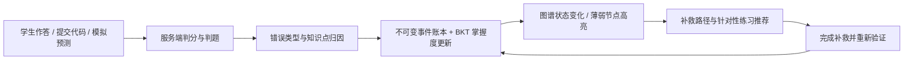

# OSLab 项目介绍

> 基于知识图谱数字孪生与实验行为闭环的操作系统智能学习平台
>
> 文档版本：2026-10-06（对应提交 `93ccf44`，feature/learning-loop-ui-rework 分支）

## 1. 项目定位

OSLab 面向操作系统课程，把**知识图谱**从静态的"课程资源展示"升级为**参与教学决策的学习引擎**：

> 学生每一次知识点作答、代码提交、模拟预测，都会转化为知识图谱上**可解释的学习证据**——平台据此自动完成薄弱点定位、补救路径规划、掌握度追踪与班级教学分析。

一句话概括三重升级：

| 传统平台 | OSLab |
| --- | --- |
| 知识图谱用于浏览 | 图谱参与诊断、推荐和评价，每名学生拥有动态"数字孪生" |
| 判题只返回对错 | 判题结果自动归因到知识节点，给出证据与下一步行动 |
| 资源推荐千篇一律 | 基于个人掌握状态的动态补救路径与针对性练习 |

核心设计原则：**每个智能判断都有证据**；判分、归因、路径规划全部具备确定性规则，**AI 是增强层而非依赖**——外部模型不可用时核心学习闭环照常运行。

## 2. 核心学习闭环



一次典型的学习体验：

1. 学生在图谱选中「页面置换」节点，进入学习工作台阅读内容；
2. 答错一道 LRU 判断题——服务端判分后，相关节点变为**薄弱（红褐）**，作答事件记录掌握度前后快照；
3. 图谱一键生成补救路径（依赖关系拓扑排序，前置知识优先），每步带可执行行动；
4. 交互模拟中完成 FIFO/LRU/OPT 预测练习，预测由服务端重算判分并计入证据；
5. 提交错误代码，异步判题返回 Wrong Answer，"向导师提问"带着题目/代码/判题上下文给出带来源的指导；
6. 修正后 Accepted，JUDGE PASS 证据让节点回升；
7. 学习记录页拖动时间轴，**回放**整个学习过程中图谱状态的前后变化；
8. 教师端从班级热力图谱下钻：首次正确率、实验通过率、常见误区一目了然。

## 3. 功能全景

### 3.1 学生侧

| 模块 | 能力 |
| --- | --- |
| 知识图谱 | 150 节点课程结构，四类关系语义（依赖/包含/相关/实现）× 个人掌握状态双维可视化；章节/状态筛选、只看学习路径、详情面板唯一主入口"进入学习" |
| 节点工作台 | 知识内容 / **知识详解**（静态 HTML 讲义，懒加载）/ 题目练习 / 实践 四页签；常驻图谱导师（GraphRAG，来源可跳转，可降级） |
| 题目练习 | 判断/单选/多选/填空四题型服务端判分；"章节→知识点→单题大卡片"学习流；单题练习与连续测评（服务端固定队列、幂等作答）；未归类章节语义统一 |
| 编程实验 | Monaco 编辑器、留页异步判题（Java/C/C++/Go）、草稿按用户/实验/语言隔离、失败后带完整上下文的"向导师提问" |
| 交互模拟 | 页面置换 FIFO/LRU/OPT、CPU 调度 FCFS/SJF/RR；步进/播放回放；预测由服务端真值判分，仅 `prediction.eventId` 存在时计入学习证据；改配置即失效旧结果 |
| 学习记录 | 事件时间线（按事件组分组，含掌握度前后快照）、待巩固清单、**只读图谱回放**（滑块/播放，当前拓扑叠加历史状态） |
| 全局 AI 助手 | 可拖动悬浮助手，按用户隔离会话，显式页面上下文注册，安全 Markdown 渲染 |
| 学习资源 | 静态交互讲义（进程调度、系统调用）与节点精确关联 |

### 3.2 教学管理侧（管理员）

| 模块 | 能力 |
| --- | --- |
| 班级分析 | 班级薄弱点**热力图谱**（列表/图谱切换）、节点下钻（首次正确率、实验通过率按提交去重、误区统计）、班级时间线、章节资源完整度 |
| 测评管理 | 四题型创建/编辑、审核状态机（DRAFT→SUBMITTED→APPROVED→PUBLISHED→OFFLINE，驳回必填理由）、JSON 导入预览/提交 |
| 知识维护 | 图谱节点/关系/章节维护、只读 Cypher 高级工具、节点学习素材编辑与发布 |
| 实验管理 | 编程实验增删改、题目集管理 |
| 用户管理 | 学生分页、批量导入、重置密码 |

## 4. 核心机制（教学契约）

### 4.1 掌握度模型（BKT）

- 五参贝叶斯知识追踪：`update(pKnown, correct, pLearn, pGuess, pSlip)`，默认 `pInit=0.10, pLearn=0.10, pGuess=0.20, pSlip=0.10`（学习转移项对对/错观测均生效，答错后验先降再叠加转移）；
- **概念/实践双分**独立追踪：知识点作答（ATTEMPT）计概念证据，判题与模拟（JUDGE/SIMULATION）计实践证据；
- 状态阈值：`薄弱 < 0.35 ≤ 待巩固 < 0.70 ≤ 已掌握`，且 GREEN 需两类证据齐备；无记录显示"尚未测评"，不把 null 当 0%；
- 可信度 = 去重来源数 × 0.25。

### 4.2 不可变学习事件账本

- 每次有效行为写入 `learning_event`：幂等键唯一（`attempt:` / `judge:` / `sim:`），同事务写入掌握度 7 字段前后快照与事件组键；
- **独立观测规则**：仅首次作答、非系统错误的判题/模拟更新模型；重复作答记录事件但快照不变；Compile Error 与系统错误只记诊断、冻结掌握度；
- 历史无快照事件自动补 `STATE_BASELINE`，不伪造历史。

### 4.3 答案隔离与公平性红线

- 学生 VO 永不下发 `correctAnswer`，解析仅在本人作答后返回；判分、候选筛选、抽样全部在服务端；
- 测评会话队列固定在服务端（`learning_assessment_run`），提交幂等键 `(userId, submissionKey)` 唯一；
- 学习接口一律从会话取当前用户，不接受外部 userId。

### 4.4 补救路径

`dependent` 边语义为"A 依赖 B"（先学 B）：多前置 BFS 闭包 + Tarjan 检环 + Kahn 拓扑排序（薄弱优先），每步输出**真实可执行**的行动（测评/模拟/实验/学习），无资源不造假入口。

## 5. 系统架构

```
浏览器
  │
  ▼
Vue 3 + Nginx ── /api ──> Spring Boot (:8121)
                              │
                ┌─────────────┼─────────────┐
                ▼             ▼             ▼
              MySQL 8      Redis         Neo4j 4.4
            （证据/状态） （会话/缓存）  （知识图谱 150 节点）
                              │
                              ▼
                      内部隔离代码沙箱（Java/C/C++/Go）
                              │
                              ▼
                    火山方舟 DeepSeek（GraphRAG 导师，可降级）
```

| 层 | 技术栈 |
| --- | --- |
| 前端 | Vue 3 + TypeScript + Arco Design Vue + ECharts（图谱）+ Monaco（编辑器）+ bytemd（sanitize 渲染）；OpenDesign 风格设计令牌（`learning-theme.css`） |
| 后端 | Spring Boot 2.7.2 + MyBatis-Plus 3.5.2 + Spring Session Redis；Long→String 全局序列化防精度丢失；窗口限流（判题 3/分、导师 6/分） |
| 判题 | 远程 HTTP 沙箱协议：本地开发用回显 stub（`scripts/dev/sandbox_stub.py`），生产为挂 docker.sock 的一次性 worker 容器（无网络、只读根、cap_drop ALL） |
| AI | 火山方舟 SDK（DeepSeek），GraphRAG 检索 = 图谱邻域 + 已发布素材 + 本人事件，无 key 自动降级为规则回答 |

**两种运行形态**：

- **本地开发**（Windows）：MySQL/Redis/Neo4j 以系统服务常驻，`start-oslab.ps1` 一键起后端 jar + 前端 dev server（:8121 / :8080-8081）；
- **Docker 生产**：`deploy/docker-compose.yml` 全栈容器化（含真实判题沙箱、Elasticsearch、防覆盖的 Neo4j 种子），仅前端暴露 :80，密码统一走 `.env`。

## 6. 数据模型

**MySQL `oslab_db`**：底座 6 表（user/students/question/question_sets/question_set_map/question_submit）+ 学习域 8 表：

| 表 | 职责 |
| --- | --- |
| learning_question / learning_question_node | 题目与题-节点映射（weight 权重） |
| learning_attempt / learning_assessment_run | 作答记录（isFirst/submissionKey）与测评会话 |
| learning_event | 不可变事件账本（幂等键、前后快照、事件组） |
| learning_mastery | 学生×节点掌握状态（pKnown/双分/证据计数/状态） |
| learning_review / learning_node_content | 审核流水 / 节点共享素材 |

**Neo4j**：`:Entity` 节点（name 为业务键，含 label 类别与 chapter 章节）+ 四类关系边。迁移脚本位于 `数据库文件/`（基础库 → v3/v4/v5 → 种子），`oslab_upgrade_existing_check.sql` 对存量库做幂等契约校验。

## 7. 快速开始

### 本地开发（原生 Windows，无 Docker）

```powershell
# MySQL/Redis/Neo4j 以 Windows 服务常驻；一键启动后端 + 前端
powershell -ExecutionPolicy Bypass -File ./start-oslab.ps1
# 停止（只停 OSLab 进程）
powershell -ExecutionPolicy Bypass -File ./stop-oslab.ps1
```

### Docker 生产形态

```powershell
powershell -ExecutionPolicy Bypass -File ./run-local.ps1        # 首次自动生成 deploy/.env
# 或在 deploy/ 下：docker compose --env-file .env up -d --build
```

### 验证

```powershell
# 后端（后端代码/osLab-backend）：默认套件 169 项全绿，遗留模板测试隔离在 legacy
.\mvnw.cmd test          # 单独跑遗留组：.\mvnw.cmd test -Plegacy
# 前端（前端代码/osLab-frontend）：lint 0 error + 构建 + 3 个 Node 裸测
npx vue-cli-service lint --no-fix && npm run build
node tests/user-identity.js; node tests/node-workbench-cache.js; node tests/knowledge-graph-render.js
# 全链路验收（需回显沙箱 + 后端指向它）：PASS=80 FAIL=0 SKIP=7，失败 exit 1
python scripts/dev/sandbox_stub.py
powershell -ExecutionPolicy Bypass -File scripts/dev/verify-learning.ps1
```

### 演示账号

密码统一 `oslab123456`（可用 `scripts/dev/prepare-demo-accounts.ps1 -DemoPassword <口令>` 幂等准备）：

| 账号 | 角色 | 说明 |
| --- | --- | --- |
| `teacher_demo` | 管理员 | 教学管理、题目维护、班级分析 |
| `student_demo1` / `student_demo2` | 学生 | 班级 os2026，两账号数据互查可验证隔离 |

## 8. 项目结构

```text
├── 前端代码/osLab-frontend/     Vue3 应用（src/views、src/api、generated OpenAPI 客户端、tests/）
├── 后端代码/osLab-backend/      Spring Boot 应用（controller / service / learning / bkt / judge / mapper）
├── 数据库文件/                  基础库 + v2-v5 迁移 + 演示/内容种子 + 存量库校验
├── 代码沙箱/                    判题沙箱 server.py / runner.py / Dockerfile
├── deploy/                      docker-compose.yml + mysql-init 加载器 + 部署文档
├── scripts/                     verify-learning.ps1（全链路验收）、prepare-demo-accounts.ps1、
│                                check-ui-terminology.ps1（术语静态检查）、sandbox_stub.py、samples/（真实判题样例）
├── docs/                        各阶段执行计划、交付记录、验收报告、人工审核清单
├── artifacts/final-check/       验收运行产物（JSON/文本清单）
└── design/                      认证页与前端视觉方案设计资产
```

## 9. 质量与验证体系

| 层 | 内容 | 当前结果 |
| --- | --- | --- |
| 前端 | ESLint 0 error、生产构建、3 个 Node 裸测（身份/工作台缓存/图谱渲染 7 场景） | 全绿 |
| 后端 | 默认套件 169 项产品测试（遗留模板测试 @Tag("legacy") 隔离），BKT/判分/调度器/置换器/路径/快照均有专项单测 | 169/0/0 |
| 集成 | `verify-learning.ps1` 8 组 87 断言（账号、图谱快照、审核链、判分与幂等、工作台、教师端、模拟、实验判题），失败 exit 1，RunKey 标记数据 | PASS=80 / SKIP=7 |
| 静态术语 | `check-ui-terminology.ps1` 扫描用户可见旧术语 | 源码零命中 |
| 人工 UI | 34 项审核清单（`docs/最终人工审核清单.md`） | 待执行 |

## 10. 当前状态与边界

- **本地可交付**：构建、产品测试、主学习闭环均有可复现证据（见 `docs/最终验收报告-2026-10-06.md`）。
- **尚未验证**：真实 Docker 沙箱判题（AC/WA/CE/RE/TLE 样例已备于 `scripts/dev/samples/`）、全新 Docker 卷初始化实跑、线上部署（现网 39.106.136.15 只读探测，未部署本轮改动）。
- **已知边界**：ECharts 像素字号与图缩放的固有权衡（缩小查看时重叠标签自动折叠）；内容种子聚焦两条知识链（内存管理→页面置换、进程→CPU 调度），其余节点使用动态模板；组件测试以 Node 裸测 + 人工清单替代（工具链无通道）。
- **后续方向（P2）**：代码行到知识点的可视化归因、自动生成图谱关系、风险预测、更多模拟主题等。

## 11. 文档索引

| 文档 | 内容 |
| --- | --- |
| `README.md` | 仓库入口：能力概览、快速开始 |
| `docs/最终验收报告-2026-10-06.md` | 最新一轮完整验收证据（分层结论） |
| `docs/最终人工审核清单.md` | 34 项人工 UI 审核清单 |
| `docs/OSLab项目最终检查与收尾执行计划.md` | 最后一轮检查的任务书 |
| `docs/log3-收尾交付记录-2026-10-05.md` / `docs/log2-OpenDesign交付记录-2026-10-04.md` | 前两轮重构的交付记录 |
| `docs/phase3-delivery.md` | 学习闭环第三阶段交付报告 |
| `知识图谱智能学习闭环方案.md` | 产品愿景与验收标准（最初方案） |
| `演示脚本.md` | 3-5 分钟现场演示主线（九步） |
| `deploy/README.md` | Docker 部署详解（沙箱、种子、恢复） |
