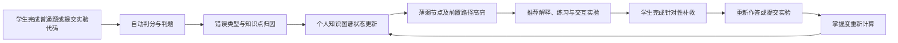

# 操作系统智能学习平台：知识图谱创新方案

## 1. 项目定位

本项目拟从传统的“课程资源展示平台”升级为：

> **基于知识图谱数字孪生与实验行为闭环的操作系统智能学习平台**

平台不再以“为每个知识节点制作一张静态讲义页面”为核心，而是利用知识点普通题、编程实验、代码提交和学习行为，持续刻画学生对各知识点的真实掌握状态，并自动完成薄弱点诊断、补救内容推荐与学习效果验证。

项目的核心价值不是“拥有一张知识图谱”，而是让知识图谱真正参与教学决策。

## 2. 核心学习闭环



典型体验如下：

1. 学生提交一道页面置换算法题，判题结果为错误。
2. 系统结合题目标签、错误类型和历史提交，将问题归因到“LRU 页面置换”和“缺页中断”等节点。
3. 知识图谱中的相关节点变红，前置知识路径同步高亮。
4. 节点详情展示掌握度下降的具体依据，而不只显示一个分数。
5. 系统推荐页面置换交互模拟器、针对性微练习和图谱增强的 AI 解释。
6. 学生完成补救后重新提交并通过。
7. 节点由红色逐渐转为绿色，学习过程被记录到成长时间轴。

## 3. 核心设计原则

### 3.1 图谱必须“活起来”

知识图谱不能只是静态关系展示。节点颜色、大小、动画和推荐顺序应当随学生行为实时变化。

### 3.2 每个智能判断都要有证据

平台需要同时展示“掌握度是多少”和“为什么得到这个判断”。证据可以包括：

- 最近相关题目的正确率；
- 普通题的首次作答结果、错因和重复作答情况；
- 最近一次提交结果；
- 连续错误次数；
- 已通过的相关实验；
- 前置知识点的掌握情况；
- 掌握度最近一次变化的原因。

### 3.3 AI 是增强层，不是唯一依赖

普通题判分、题目与知识点映射、基础错误归因、掌握度计算和学习路径生成应具备确定性规则。AI 用于生成更自然的解释、补充关系和对话辅导。即使外部模型暂时不可用，核心学习闭环仍然可以运行。

### 3.4 内容采用模板化动态组织

只建设一个通用的知识节点学习工作台，由节点属性、图谱关系、关联题目、学生状态和少量结构化素材动态生成内容，避免为每个节点重复开发页面。

## 4. 重点创新功能

### 4.1 学生知识状态数字孪生

系统为每名学生维护一张个性化知识图谱。同一个知识节点，在不同学生的图谱中可以呈现完全不同的状态。

建议状态包括：

- **绿色：** 已掌握；
- **黄色：** 基本理解但稳定性不足；
- **红色：** 当前薄弱或近期发生错误；
- **灰色：** 尚未学习或证据不足；
- **紫色光环：** 系统当前推荐学习的节点；
- **脉冲效果：** 刚刚因一次提交而发生状态变化。

掌握度和可信度应分开表达。例如，“掌握度 80、可信度低”表示学生只完成了少量题目，不能简单认定为完全掌握。

### 4.2 判题失败到知识节点的自动归因

平台将一次代码提交转换为可解释的学习诊断。

归因信息可以综合：

- 题目关联的知识节点；
- WA、RE、TLE、编译错误等判题结果；
- 失败测试用例或输入规模；
- 代码运行特征；
- 学生在相关节点上的历史表现；
- 前置知识节点是否薄弱。

输出结果应包含：

- 最可能相关的知识点；
- 归因置信度；
- 支持该判断的证据；
- 推荐的下一步学习动作。

### 4.3 动态知识节点学习工作台

所有节点共用一个动态页面，例如：

`/knowledge/node/:id`

页面按需组织以下模块：

- 一分钟概念卡；
- 前置知识与后继知识；
- 当前掌握度、可信度及变化原因；
- 最近相关错误；
- 常见误区；
- 关联的判断、选择、填空等普通题和编程实验；
- 推荐学习路径；
- AI 图谱导师；
- 交互式算法演示入口。

这样只需维护结构化知识、关系和资源映射，就能让大量节点具备完整的学习能力。

### 4.4 知识点普通题与即时反馈

每个知识节点应能关联普通题，覆盖概念识记、关系辨析和简单应用。普通题与编程实验共同构成学习证据：普通题检查学生是否理解概念和规则，实验检查能否把知识用于实际问题。

首批支持四种题型：

- **判断题：** 检验定义、条件和常见误区；
- **单选题：** 检验概念区分和算法步骤；
- **多选题：** 检验多个条件是否同时成立；
- **填空题：** 检验术语、公式、关键步骤和计算结果。

每道题可关联一个或多个知识节点，并记录题目难度、考查目标、标准答案、解析及常见错误选项的含义。学生可以从知识节点进入练习，也可以按章节浏览普通题；两种入口使用同一套题目与作答记录。

普通题由服务端判分，提交后立即反馈对错、解析和对应知识节点。多选题应明确是否要求完全匹配；填空题应支持教师审核的同义答案与必要的格式规范，避免因空格或等价写法误判。标准答案和判分规则不应在作答前下发到浏览器。

第一次作答、再次作答和查看解析应分别记录。掌握度计算应更重视首次独立作答，重复刷同一道题的收益递减；看过解析后的正确作答仍可作为进步证据，但不能等同于首次答对。

普通题答错时，系统直接标记其关联知识节点和常见误区，并推荐前置概念或同目标的变式题。这样没有编程实验的知识点也能形成“诊断—补救—验证”的闭环。

### 4.5 GraphRAG 图谱导师

AI 回答问题时，应优先检索并使用：

- 当前知识节点；
- 前置和后继节点；
- 相关题目与实验；
- 学生最近提交记录；
- 平台内经过审核的知识素材。

回答中明确标注依据来源，例如“根据节点‘缺页中断’”“根据你最近一次 LRU 提交”。这使 AI 辅导具有课程上下文和个人学习上下文，区别于普通聊天机器人。

GraphRAG 导师还应具备教学约束：

- 默认先给提示，再逐步展开答案；
- 不直接替学生完成全部实验代码；
- 能根据学生掌握状态调整解释深度；
- 回答无法从平台证据中确认的问题时明确说明不确定性。

### 4.6 交互式操作系统算法实验室

优先建设页面置换模拟器，支持 FIFO、LRU 和 OPT：

- 输入页面访问序列与物理块数量；
- 逐步展示内存页面状态；
- 标记命中、缺页和被淘汰页面；
- 支持播放、暂停、单步执行和时间轴回放；
- 对比不同算法的缺页次数和缺页率；
- 插入预测题，让学生判断下一步淘汰哪个页面；
- 将交互结果作为掌握度计算的新证据。

可扩展的精品实验包括：

- CPU 调度甘特图及算法对比；
- 银行家算法与死锁安全序列演示；
- 连续内存分配与碎片可视化；
- 进程状态转换和信号量执行过程演示。

精品实验不需要覆盖全部节点，重点是形成少量能够代表平台特色的高质量演示。

### 4.7 动态学习路径规划

系统根据图谱依赖、学生目标和掌握状态生成学习路径，而不是提供统一目录。

示例路径：

`地址空间 → 页表 → 缺页中断 → 页面置换 → LRU 实验`

路径中的每一步都应说明推荐原因，例如：

- 它是当前薄弱节点的直接前置知识；
- 它是完成目标实验的必要基础；
- 学生最近在相关题目中连续失败；
- 该节点修复后会影响多个后继节点。

### 4.8 知识成长时间轴

平台记录每次关键学习事件对图谱的影响。学生可以拖动时间轴，回放节点从灰色、红色、黄色到绿色的变化过程。

时间轴事件包括：

- 完成题目；
- 完成知识点普通题及纠错；
- 代码提交失败或通过；
- 完成交互实验；
- 完成微测验；
- 掌握度跨越状态阈值；
- 系统重新规划学习路径。

这一功能能够直观展示平台确实在持续追踪学习过程，也是比赛现场效果很强的可视化能力。

### 4.9 教师端班级薄弱点图谱

将全班学生的个人掌握状态聚合为班级热力图，帮助教师回答：

- 哪些知识点是全班共同瓶颈；
- 哪个前置节点影响了最多后续内容；
- 哪道题造成了大量相同错误；
- 哪些学生需要优先干预；
- 教学后知识状态是否明显改善。

系统只展示聚合结论还不够，还应允许教师下钻查看相关题目、常见错误类型和匿名化学习证据。

## 5. 功能优先级

### P0：构成完整闭环的必要能力

- 题目与知识节点映射；
- 知识点普通题及判断、单选、多选、填空的服务端判分；
- 从知识节点和章节进入同一套普通题练习；
- 学生节点掌握度与可信度；
- 图谱红黄绿热力着色；
- 掌握度变化原因展示；
- 判题失败自动归因；
- 动态知识节点学习工作台；
- 补救练习与再次验证。

### P1：形成比赛辨识度的核心亮点

- 页面置换交互模拟器；
- GraphRAG 图谱导师；
- 个性化学习路径；
- 知识成长时间轴；
- 教师端班级薄弱点图谱。

### P2：进一步炫技的扩展能力

- 代码行到算法步骤再到知识节点的视觉连线；
- AI 辅助发现题目标签和图谱关系；
- 多种操作系统算法的交互实验；
- 学习路径效果对比；
- 节点掌握状态的预测与风险预警。

## 6. 建议的数据与系统结构

### 6.1 关系数据库保存学习证据

适合保存：

- 用户、题目和提交记录；
- 普通题作答、判分、解析查看与实验提交等学习证据；
- 题目与知识节点的映射；
- 节点掌握度快照；
- 掌握度变化事件；
- 推荐记录和学习行为；
- AI 归因结果及缓存。

### 6.2 Neo4j 保存知识结构

适合保存：

- 知识节点；
- 前置、包含、相似、应用于等关系；
- 知识点与实验之间的关联；
- 学习路径查询所需的图拓扑。

### 6.3 建议的核心数据对象

#### 学生节点掌握状态

```text
userId
knowledgeNodeId
masteryScore
confidence
status
lastEvidenceType
lastEvidenceId
reasonSummary
updatedAt
```

#### 掌握度变化事件

```text
userId
knowledgeNodeId
eventType
scoreBefore
scoreAfter
evidenceId
reason
createdAt
```

#### 题目知识映射

```text
questionId
knowledgeNodeId
weight
relationType
source
reviewStatus
```

其中 `source` 可区分教师人工配置、规则生成和 AI 建议；AI 生成的映射应经过审核后再成为正式教学数据。

#### 普通题与作答记录

普通题保存题型、章节、题干、选项、难度、标准答案、可接受答案和解析。作答记录保存学生、题目、提交答案、判分结果、作答次数、是否已查看解析及作答时间。标准答案只在服务端保存和判分。一道普通题可以关联多个知识节点，并为不同节点设置不同权重。

## 7. 掌握度模型建议

掌握度可以由以下信号组合计算：

- 相关题目的正确率；
- 普通题的首次作答、错误类型与纠错结果；
- 首次通过率与尝试次数；
- 最近表现；
- 不同难度题目的覆盖度；
- 交互实验和微测验结果；
- 前置节点掌握情况。

同时增加两个重要机制：

1. **时间衰减：** 长期没有练习的节点逐渐降低可信度，而不是武断地直接判定为遗忘。
2. **前置传播：** 前置节点薄弱时，为后继节点增加风险提示，但不能直接把后继节点判定为不会。

所有权重应当配置化，并保留每次分数变化的证据，便于后续通过真实数据校准模型。

普通题与编程实验应分别统计，再按知识节点的考查目标组合，避免仅靠背诵题目就把实践性知识判定为完全掌握。重复作答同一题时应降低其权重；覆盖不同题目和不同难度才逐步提高掌握度可信度。

## 8. 首个可展示版本的边界

首个版本不必覆盖整门课程。建议选择一条完整且视觉效果明显的知识链：

`存储管理 → 虚拟内存 → 缺页中断 → 页面置换 → FIFO/LRU/OPT`

围绕这条链配置：

- 一组结构清晰的知识节点及关系；
- 覆盖判断、单选、多选、填空的知识点普通题，并支持按节点与章节进入；
- 一道可真实判题的实验；
- 一套失败归因规则；
- 一个页面置换交互模拟器；
- 一段完整的状态变化记录。

完成这条纵向闭环，比铺开大量只有标题和简介的节点更能证明系统价值。

## 9. 比赛演示脚本

1. 展示某位学生的个性化知识图谱。
2. 学生提交 LRU 页面置换实验，判题失败。
3. “LRU”和相关前置节点出现闪烁与颜色变化。
4. 右侧诊断卡展示错误归因、置信度及证据。
5. 系统生成一条最短补救路径。
6. 学生完成关联知识节点的判断题和填空题，系统即时解释错因并更新节点状态。
7. GraphRAG 导师结合图谱、本次提交及普通题错因进行分层提示。
8. 学生进入页面置换模拟器，完成预测与交互练习。
9. 学生重新提交并通过，节点由红色渐变为绿色。
10. 拖动时间轴，回放本次学习前后的知识状态变化。
11. 切换至教师端，展示班级在该知识链上的整体改善。

## 10. 与普通教学平台的差异

| 普通平台 | 本项目 |
| --- | --- |
| 知识图谱用于浏览 | 知识图谱参与诊断、推荐和评价 |
| 所有学生看到同一张图 | 每名学生拥有动态知识状态数字孪生 |
| 判题只返回对错 | 判题结果进一步归因到知识节点 |
| 普通题与实验题各自孤立 | 两类作答共同更新知识状态，并保留不同证据 |
| AI 是通用聊天窗口 | AI 基于课程图谱和个人学习证据回答 |
| 学习内容是静态页面 | 节点工作台按知识关系和学生状态动态组织 |
| 推荐题目缺少解释 | 每条推荐展示路径依据和薄弱证据 |
| 只能查看当前成绩 | 可以回放知识状态的成长过程 |

## 11. 验收标准

平台达到以下条件后，才能认为核心创新已经真正落地：

- 一次真实提交能够触发知识节点状态变化；
- 判断、单选、多选、填空题能从知识节点与章节进入，服务端判分并即时反馈；
- 普通题的首次作答和纠错能留下不同的学习证据，并影响关联节点的掌握度；
- 节点状态变化能够展示可追溯证据；
- 不同学生看到的节点状态存在合理差异；
- 系统能够从薄弱节点生成可执行的补救路径；
- 补救活动完成后能够重新评估掌握度；
- AI 回答能够引用平台内的节点、题目或提交依据；
- AI 服务不可用时，普通题判分、实验判题、归因、图谱更新和基础推荐仍可运行；
- 至少有一个交互式算法实验与题目、图谱、掌握度完整联动；
- 教师能够看到班级层面的薄弱知识结构；
- 比赛演示可以使用预置账号和稳定数据完整走通。

## 12. 项目宣传表达

### 一句话介绍

> 平台把学生每一次普通题作答和代码提交转化为知识图谱中的可解释学习证据，并自动完成薄弱点定位、补救路径规划与掌握效果验证。

### 核心创新概括

> 从“展示知识关系”升级为“追踪知识状态”，从“返回判题结果”升级为“解释错误原因”，从“统一资源推荐”升级为“基于个人知识数字孪生的动态补救”。

### 建议项目名称

- **OSGraph Twin：操作系统知识数字孪生学习平台**
- **OS-Lens：面向实验行为的操作系统认知诊断平台**
- **智图 OS：知识图谱驱动的操作系统智能实践平台**
